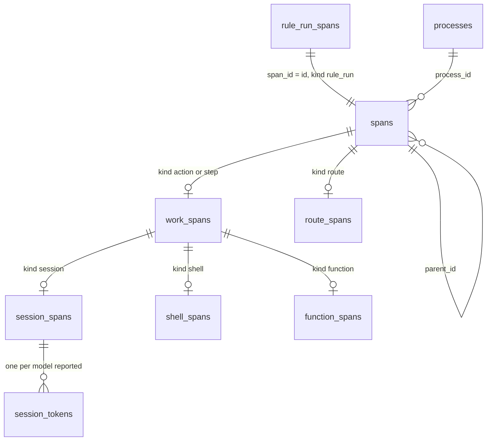

## Goal Capsule

- **Objective:** the domain has the action, route and step span records, and the SQLite store keeps each span once, with its kind's detail, its token records by model and its first end; nothing emits them yet.
- **Parent:** #343, part 1 of 4. Read it only for a question this part does not answer.
- **Open blockers:** none.
- **Authority:** the Product Contract's requirements and Key Decisions win on behaviour; the KTDs win on mechanism; units override neither.
- **Stop conditions:** stop and report if a migration cannot only add.

## Product Contract

### Summary

The records `crew.ActionSpan`, `crew.RouteSpan` and `crew.StepSpan`, each kind's work detail and outcome, the prompt template's hash, the migration `0004_work_spans.sql` with the store's writes, and the `StatisticNotRecorded` words for each record. The core records none of them yet: parts 2 and 3 do.

### Context

Recording a span needs a record to emit and a store that keeps it. This part builds some of R10 to R14, which later parts complete (R10, R11 and R12 part 4; R13 part 3; R14 part 2):

**The spans**

- R10. Each action that ends is a span inside its rule run, with its name, its kind (session, shell or function), its outcome, its start, its end and the crew process that ran it.
- R11. When an action's verdict leads to a route, the route is a span inside the action, with the verdict that chose it, its start and its end; each shell or function step of the route is a span inside it, with its name, its kind, its outcome, its start, its end and the crew process that ran it.

**What each kind adds**

- R12. A session span adds its agent, harness and bot, a hash of its action's prompt template, its turns, and the tokens the harness reported for each model: input, output, cache read and cache write.
- R13. A shell span, action or step, adds its exit status. Shell, function and route spans count 0 tokens.
- R14. A session whose harness reported no usage, such as one crew stopped or one that crashed, has no token records, and its tokens read as not reported.

In the text copied from #343, "part 1", "part 2" and "part 4", and their KTDs, name parts of #315, already on main, not this split's parts.

### Key Decisions

- **Spans in a tree, not flat records.** An issue holds rule runs, a rule run holds actions, an action holds the route its verdict chose, and a route holds its steps; later slices add subagents, model calls, tool calls and waits as children. Each span inherits its issue, rule and repository from its ancestors instead of repeating them. Governs R9, R10, R11. (session-settled: user-approved — chosen over one flat record per action that repeats the issue, rule and queue: the tree normalizes the dimensions and each later slice adds a span kind without redesigning the base)
- **Routes are spans.** The route links a verdict to what followed it, so the statistics tell how often an action ends in each route and what the actions that ended there cost. Governs R11. (session-settled: user-directed — chosen over recording route steps loose inside the rule run)
- **The process is recorded once, like a telemetry Resource, and is not a level of the tree.** One crew process works on many issues and one issue's runs span many processes, so every span points to the process that ran it. Governs R5, R10, R11. (session-settled: user-approved — chosen over issue → process → rule run: the relation is many-to-many)
- **Each kind's detail is its own type.** Session, shell, function and route spans each carry only their own fields, in the shape of a sealed interface. A field uses its zero value for "absent" only where zero is never a valid value. The one real absence, a session's unreported usage, is explicit. Governs R12, R13, R14. (session-settled: user-approved — chosen over one record type with optional fields for every kind)
- **Unreported usage is not zero.** A measure that will gain its own granularity lives in its own records: a session's tokens are records by model that exist only when the harness reported them, so a stopped session reads as not reported and a shell reads as 0. Governs R13, R14. (session-settled: user-approved — chosen over a nullable token column and over storing 0: zero would make failed sessions look free)
- **The core decides what to record, the engine writes it.** The core already knows the issue, its labels, the run's rule, action, bot, verdict and route, so it builds the records and emits commands; the engine executes them through the port, the way it executes journal records today. Crew's own time reaches the core with the fact the engine hands it, so the core keeps no clock. Harness-specific detail stays in the harness's adapter. Governs R7, R8, R9, R10, R11, R12, R16. (session-settled: user-approved — chosen over the engine assembling records on its own: the core keeps the decision pure and table-testable)
- **Tokens, no money.** The statistics count tokens and time; cost is not stored. Governs R12.

### Requirements

**What each kind adds**

- R15. The store holds no prompt text, tool arguments or session output; the prompt template is stored only as its hash.

### Acceptance Examples

- AE4. **Covers R9, R10, R12.** Given an `lfg` session for #243 that used Opus and, through its subagents, Sonnet, when the session ends with a verdict, the rule run's span under #243 holds a session span with the agent, harness and bot, the prompt template's hash, the turns, and one token record for each of the two models.
- AE5. **Covers R11, R13.** Given an action whose verdict leads to a route with a shell step that exits 0 and a function step, the action's span holds the route's span with the verdict that chose it, and the route's span holds the two steps' spans, the shell one with exit status 0; the route and its steps count 0 tokens.
- AE6. **Covers R14.** Given a session crew stopped, when its action ends, its span has the outcome stopped and no token records; a sum of the issue's tokens counts the reported sessions and says one session did not report.
- AE7. **Covers R13.** Given a shell action that exits with status 1, its span has exit status 1 and counts 0 tokens.
- AE9. **Covers R4, R6.** Given two crew processes on two repositories that end actions at the same moment, the store holds both spans, each under its own repository's issue.
- AE10. **Covers R5, R9, R10.** Given crew restarts in the middle of a rule run, the run's span stays under its issue, the actions that ended before the restart point to the first process, and the actions that end after it point to the second.

### Scope Boundaries

- Recording the spans is parts 2 (actions) and 3 (the route and its steps); the engine's end-to-end test and the README, CONCEPTS.md and AGENTS.md are part 4.
- Cost in money is not stored. The live view and the status comment keep showing it as they do today.

### Sources / Research

Split from #343.

- `internal/crew/usage.go`.
- OpenTelemetry Go: the trace model of spans, and `metricdata`'s sealed `Aggregation` interface.
- `docs/plans/2026-10-09-2214-issue-342-plan.md` and `docs/solutions/design-patterns/rule-run-spans-differ-from-the-342-plan.md`: part 4's span, and where the shipped code differs from its plan (the halt only on `failed`, three causes of an open span, the first end kept by a conditional update gated on `RowsAffected`).
- `docs/solutions/design-patterns/statistics-store-decides-restart-and-duplicate-label-moves.md`: memory across processes lives in the record's immediate transaction, never in a startup read.

## Planning Contract

### Key Technical Decisions

- KTD1. **Span ids derive from the rule run's id.** An action's span is `<run>/action/<action>`, the route's `<run>/route`, and a step's `<run>/route/<index>`, the step's index in the route. Each id names one span for good:
  - config rejects two actions of one rule with the same name (`checkNames`, `internal/config/graph.go`);
  - a run's cursor only moves forward, so an action runs at most once per run;
  - a run chooses at most one route;
  - a restart takes a new run with a new id (part 4's KTD1).

  A derived id makes a repeated record land on the same row, so `ON CONFLICT DO NOTHING` and the first-end update stay idempotent, as they are for rule run spans. The `action/` and `route` prefixes keep an action named `route` apart from the route. `RuleRunID.TakeReport` (`internal/crew/identity.go`) already derives a sub-id the same way. Governs R10, R11.
- KTD2. **A span is written no later than its first child.** That rule decides when each kind is written:
  - an action's span is written once, at its `ActionEnded`, with its start and end: its only child, the route, comes after it;
  - a route's span is written open at its `RouteChosen`, before any step, and again with its end at `RunReleased`, before the rule run's end;
  - a step's span is written once, at its `StepEnded`.

  Like the rule run span, every record carries the whole span, and the store keeps the first end (part 4's KTD5). R10 asks for each action that ends, so an action still running when crew is killed leaves no span. Its rule run span stays open, as AE11 already says. The README names this beside part 4's three causes of an open span. Records are emitted from the live handlers in `internal/core/runs.go` and `internal/core/steps.go` only, after the event is applied. A replayed journal folds `History` and records nothing. Governs R10, R11, F2.
- KTD5. **Each kind's outcome says how it ended, and an action's outcome carries its halt.** One outcome type serves action and step spans:

  | Outcome | Action | Step |
  |---|---|---|
  | `succeeded` | `EndSucceeded` | `StepRan` |
  | `failed` | `EndFailed` with any other cause | `StepFailed` |
  | `stopped` | `EndFailed` with `CauseStopped` | `StepStopped` |
  | `stopped_before_start` | `EndFailed` with `CauseStoppedBeforeStart` | `StepSkipped` |
  | `run_time_limit` | `EndFailed` with `CauseTimeUp` | none |

  This is the halt answer each new kind needs (`docs/solutions/design-patterns/rule-run-spans-differ-from-the-342-plan.md`): a halt chose an action's or step's end exactly when its outcome is one of the last three. Once crew's stop reached the run, a session that ends, even on its own, is `stopped`: `judgeSession` (`internal/crew/verdict.go`) gives `CauseStopped` whatever the harness said. A session that ends on its own after the run time is up keeps its own outcome. When its verdict leads to a next action, the time limit keeps that action from starting (`run_time_limit`) and sends the run through `failed`. A route's outcome is the rule run's, from `outcome` in `internal/core/statistics.go` (`routed`, `route_dropped`, `route_given_up`). The halt that sent the run through `failed` stays on the rule run span alone. Governs R10, R11, AE6.
- KTD6. **One migration adds a table per kind and an index by parent; `spans.kind` names the span's level.** `0004_work_spans.sql` only adds:
  - `spans.kind` takes `action`, `route` and `step` beside `rule_run`. `parent_id` is the rule run's id for an action, the action's span or the rule run's for a route (KTD9), and the route's for a step. A new index `spans_by_parent` serves the recursive walk down a demand's tree.
  - `work_spans`, keyed by `span_id`: the `name` and the `kind` of an action or step (`session`, `shell`, `function`, `question` or `check`), and an action's `verdict`, null for a step. An action that went on to the next one keeps its verdict here, as no route records it.
  - `session_spans`: `agent`, `harness`, `bot` (null for the tracker's own identity), `prompt_hash`, `session_started_at` (null when the session never started) and `turns` (null when not reported). A session that never started has no token records either. Its null start tells it apart from a session that ran and did not report (KTD7).
  - `session_tokens`, keyed by `span_id` and `model`: `input`, `output`, `cache_read` and `cache_write`, one row per model the harness reported (KTD7).
  - `shell_spans`: `exit_status`, null when the script did not exit.
  - `function_spans`: the registered `function` and the `verdict` it returned, null when it returned none.
  - `route_spans`: `route` and the `verdict` that chose it, null when no action of the run chose it.

  No table stores a reason, a log path or a rendered prompt: an action's reason can carry its script's last printed line or its session's result text (R15). As in `0003`, there are no foreign keys. Each record writes its `spans` row and its kind's rows with `ON CONFLICT DO NOTHING` in one immediate transaction. A route's end runs the `spans` end update `WHERE ended_at IS NULL`. Nothing else of a route changes at its end, so no second update needs gating. `spans.kind` stays the level and `work_spans.kind` the kind, so a query for all actions or all steps reads one column, and one for every session reads `work_spans`. Writes stay `const` statements in `internal/adapter/sqlite/store.go`; read queries are not part of this work. Governs R10, R11, R12, R13, R14, R15.
- KTD7. **Three new record types, each kind's detail a sealed interface, and tokens absent until reported.** `crew.ActionSpan`, `crew.RouteSpan` and `crew.StepSpan` join `Statistic`. An action or step span holds its work's detail as one of `SessionWork`, `ShellWork`, `FunctionWork`, `QuestionWork` or `CheckWork`; a step only ever holds the shell or function ones. Records compute their own ids and parent ids (KTD1, KTD9), so the store and the tests share one rule. `SessionWork` keeps its tokens optional:
  - when the harness reported usage by model (`Usage.ByModel`), one record per model;
  - when it reported only a sum (`Usage.Tokens` with no `ByModel`, as Codex does), one record with no model name;
  - when it reported no tokens, none, which reads as not reported (R14), as a stopped or crashed session does (`port.UsageReporter`).

  Turns stay `Optional[int]`, as `Usage.Turns` is. `SessionWork` also keeps when the session started, from `ActionEnded.SessionStarted`, none when it never started. A workspace that failed, a session that could not start, a prompt that did not render or a halt all leave no token records, so they read as not reported, as R14 says. The session start lets a sum tell the sessions that ran and reported nothing from the ones that never ran. It is stored now because rows written without it could not get it later. A stopped session is not always one with no tokens: a Claude Code session stopped after an earlier result reports what it had. AE6 is a stopped session whose harness reported nothing. The records also carry the rule run's rule and issue, for crew's warning words only: the store writes neither, since the tree gives them (Key Decisions). Governs R12, R13, R14.
- KTD8. **The prompt hash is SHA-256, in hex, of the action's template as the config wrote it.** It comes from `Prompt.Text()` (`internal/crew/prompt.go`), through a method on `Prompt`, with the standard library's `crypto/sha256`. It hashes the template only, not the action's name: the span already names the action, and the same template in two actions is the same prompt to a later prompt catalog. An edit to the template gives a new hash, which tells its versions apart. The rendered prompt, the issue's text and crew's own paragraphs (resume, verdict, waiting, answers) are not in it. Answers the deferred question of what the hash covers. Governs R12, R15.
- KTD9. **A route hangs from the action whose verdict chose it, when that action ran in this run, and from the rule run otherwise.** `RouteChosen.Action` names the action at the cursor. A rule without actions names none. A run of its continued run's passed route alone (`StartPassedRoute`) names an action that is `DoneInEarlierRun`, whose span belongs to the earlier run. In both, the route's parent is the rule run, and its verdict is none. The test is the named action's state in this run, `Finished`, not whether a name is given. Otherwise the verdict is the action's `Finished.Verdict`, `passed` included when the action went on past the last action. Governs R11.

### High-Level Technical Design

The tables after this part (KTD6):

### Assumptions

These are unconfirmed bets made while planning, with nobody to ask. Review them in the pull request.

- R10 names three kinds; a rule also has question actions and the answered rule's check. They are recorded too, as `question` and `check`, with no detail table, so a route chosen by their verdict always has a parent span. A question action ends at once, so its span starts and ends together.
- A Codex session reports a token sum with no model. It gets one token record with an empty model name, so its tokens count as reported. Only a session with no token usage at all reads as not reported, and its session start tells whether it ran.

### Deferred to Implementation

- The exact names of the record types, the work detail types and the outcome type and its constants.
- The words `internal/ui/lines` uses for each new record in the `StatisticNotRecorded` warning.

### Sequencing

U1 alone: the records and the prompt hash, then the migration and the store writes, then the warning words.

## Implementation Units

### U1. The span records, their tables and their warning words

**Goal:** the domain has the action, route and step span records, and the SQLite store keeps each span once, with its kind's detail and its first end.

**Requirements:** R10, R11, R12, R13, R14, R15 (KTD1, KTD5, KTD6, KTD7, KTD8, KTD9).

**Dependencies:** none.

**Files:**
- Modify `internal/crew/statistic.go` (the three variants, the work detail interface and its five types, the outcome type of KTD5, and the id and parent methods of KTD1 and KTD9).
- Modify `internal/crew/prompt.go` (the hash of KTD8).
- Create `internal/adapter/sqlite/migrations/0004_work_spans.sql`; modify `internal/adapter/sqlite/migrate.go` (embed it, list it fourth) and `internal/adapter/sqlite/store.go` (a `Record` case for each variant, `insertSpan` taking its kind and parent).
- Modify `internal/ui/lines/lines.go` (`statistic` names each new record).
- Test `internal/crew/statistic_test.go` (new), `internal/crew/prompt_test.go`, `internal/adapter/sqlite/work_spans_test.go` (new), `internal/adapter/sqlite/store_test.go` (`migrations` becomes 4), `internal/adapter/sqlite/concurrent_test.go`, `internal/ui/lines/lines_test.go`.

**Approach:**
- The migration follows `0003_spans.sql`: the `tsqllint-disable` header, a comment on each table saying what a row is, and no foreign key.
- `insertSpan` takes the kind and the parent instead of the fixed `'rule_run'`; the rule run case passes `rule_run` and no parent, so its rows stay as they are.
- A route's end reuses `updateSpanEnd`, the conditional update part 4 ships.
- The `sumtype` linter makes every switch over `Statistic` handle the new variants; `internal/fake/statistics.go` keeps any record as it is.

**Patterns to follow:** `span`, `insertSpan`, `updateSpanEnd`, `unixMilli` and `text` in `internal/adapter/sqlite/store.go`; `opened`, `ended`, `spanRow` and `wantSpan` in `internal/adapter/sqlite/spans_test.go`; `TestAStoreOfVersionTwoMigratesAndKeepsItsRows` and the two-store test in `concurrent_test.go`.

**Test scenarios:**
- Covers AE4. A session action span of `lfg` in run `r.1`, agent `claude`, harness `claude`, bot `crew-developer`, a prompt hash, 12 turns and token records for `claude-opus` and `claude-sonnet` writes a `spans` row with kind `action` and parent `r.1`, a `work_spans` row with kind `session`, a `session_spans` row and two `session_tokens` rows.
- Covers AE6. A session span with outcome `stopped`, a session start, no turns and no tokens writes no `session_tokens` row and a null `turns`. Beside it, a reported session and a session that never started (null `session_started_at`): a sum of the issue's tokens over its spans counts the reported one and says one started session did not report.
- A session with tokens of zero by one model writes one row of zeros, told apart from no row.
- A session span whose tokens are a sum with no model writes one row with an empty model.
- A session span with no bot stores a null `bot`.
- Covers AE7. A shell action span with exit status 1 writes `shell_spans` with 1, and no `session_tokens` row.
- A shell span whose script did not exit stores a null `exit_status`.
- A function action span stores its function's name and the verdict it returned; one that returned none stores a null verdict.
- A question and a check span write their `spans` and `work_spans` rows only.
- Covers AE5. A route span open record writes kind `route`, parent the action's span, route `passed` and verdict `passed`, with no end. Its end with outcome `routed` sets the end and the outcome.
- A route span whose end record arrives without its open writes the whole span. A second end keeps the first.
- A route span with no action writes the rule run's id as its parent and a null verdict.
- Covers AE5. A shell step span at index 0 and a function step span at index 1 of the route write kind `step`, parent `r.1/route`, and their detail rows.
- Writing the same action span twice leaves one row in each table.
- Covers AE9. Two stores in two goroutines write action spans of runs in two repositories at once and both spans are kept, each under its own rule run.
- A store at version 3, holding a rule run span, migrates to 4 and keeps its rows.
- The hash of a template is the SHA-256 hex of its text. Two prompts of one text in two actions hash the same, and a changed text hashes differently.
- The id of an action named `route` differs from the route's id.
- `lines` names a failed action, route and step record in the `StatisticNotRecorded` warning, and tells a route's open from its end.

**Verification:** the crew, sqlite and lines tests pass, and `migrations` counts 4.

## Verification Contract

| Gate | Command | Applies to |
|---|---|---|
| Format | `gofmt -l cmd internal tools` prints nothing | every unit |
| Vet | `go vet ./...` | every unit |
| Lint and layering | `go run github.com/golangci/golangci-lint/v2/cmd/golangci-lint@v2.14.0 run` | every unit |
| Tests | `go test -race ./...` | every unit |
| Coverage floor | `go test -race -covermode=atomic -coverpkg=./... -coverprofile=coverage.out ./...`, then `go run github.com/vladopajic/go-test-coverage/v2@v2.19.0 --config=.testcoverage.yml` (total at least 90%) | before the pull request |
| Module tidy | `go mod tidy` changes nothing | before the pull request |
| Vulnerabilities | `go tool govulncheck ./...` | before the pull request |

## Definition of Done

- Every unit's Verification holds, and every gate above passes.
- Code from abandoned approaches is removed from the diff.

## Scope Boundaries (planning)

### Deferred to Follow-Up Work

- Queries or a report over the spans: this part writes them only.

### Considered and not built

- **A column that says a session reported usage.** The token records' presence already says it (R14). A second signal could disagree with the rows.
- **Hashing the rendered prompt.** It differs per issue, so it cannot identify a prompt, and it would tie the hash to issue text the store must not hold (R15).

<!-- cw-split-ce-plan: part of #343 -->

<!-- publish-split: part 1 of #343 -->

