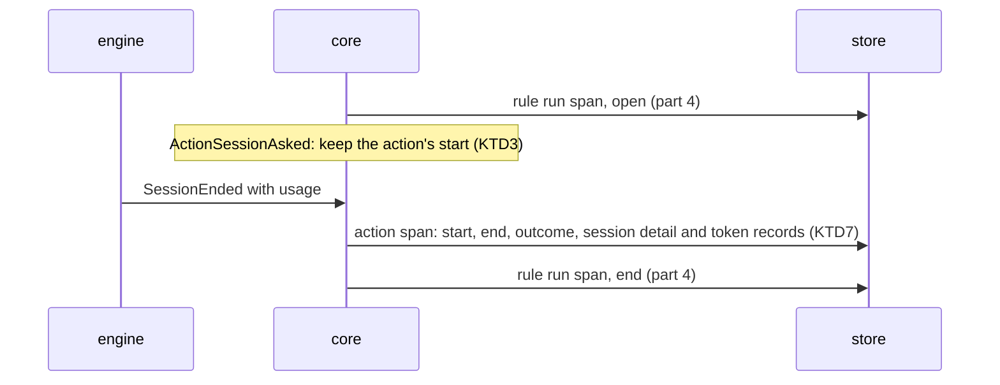

## Goal Capsule

- **Objective:** the core records every action of a rule run as a span under its run when it ends, with its kind's detail, its start, its end and its process, and the engine writes it through the configured store.
- **Parent:** #343, part 2 of 4. Read it only for a question this part does not answer.
- **Open blockers:** none.
- **Authority:** the Product Contract's requirements and Key Decisions win on behaviour; the KTDs win on mechanism; units override neither.
- **Stop conditions:** stop and report if an action can run twice under one rule run id (KTD1 of #343 rests on it).

## Builds on

Already on main when this part starts; read the code, not these parts' files.

- Part 1 (U1): the action, route and step span records with their work detail, outcome, ids and parents, the prompt template's hash, and the SQLite tables and writes that keep them.

## Product Contract

### Summary

The held run keeps the time crew asked for each action, and each `ActionEnded` records the action's span with its session, shell, function, question or check detail. The engine already writes any `crew.Statistic`, so each action's span reaches the store.

### Context

This part tells what each action of a demand cost in time and tokens. It builds some of R10, R12 and R13, which part 4 (R10, R12) and part 3 (R13) complete:

**The spans**

- R10. Each action that ends is a span inside its rule run, with its name, its kind (session, shell or function), its outcome, its start, its end and the crew process that ran it.

**What each kind adds**

- R12. A session span adds its agent, harness and bot, a hash of its action's prompt template, its turns, and the tokens the harness reported for each model: input, output, cache read and cache write.
- R13. A shell span, action or step, adds its exit status. Shell, function and route spans count 0 tokens.

In the text copied from #343, "part 1", "part 2" and "part 4", and their KTDs, name parts of #315, already on main, not this split's parts.

### Key Decisions

- **Spans in a tree, not flat records.** An issue holds rule runs, a rule run holds actions, an action holds the route its verdict chose, and a route holds its steps; later slices add subagents, model calls, tool calls and waits as children. Each span inherits its issue, rule and repository from its ancestors instead of repeating them. Governs R9, R10, R11. (session-settled: user-approved — chosen over one flat record per action that repeats the issue, rule and queue: the tree normalizes the dimensions and each later slice adds a span kind without redesigning the base)
- **The process is recorded once, like a telemetry Resource, and is not a level of the tree.** One crew process works on many issues and one issue's runs span many processes, so every span points to the process that ran it. Governs R5, R10, R11. (session-settled: user-approved — chosen over issue → process → rule run: the relation is many-to-many)
- **Each kind's detail is its own type.** Session, shell, function and route spans each carry only their own fields, in the shape of a sealed interface. A field uses its zero value for "absent" only where zero is never a valid value. The one real absence, a session's unreported usage, is explicit. Governs R12, R13, R14. (session-settled: user-approved — chosen over one record type with optional fields for every kind)
- **Unreported usage is not zero.** A measure that will gain its own granularity lives in its own records: a session's tokens are records by model that exist only when the harness reported them, so a stopped session reads as not reported and a shell reads as 0. Governs R13, R14. (session-settled: user-approved — chosen over a nullable token column and over storing 0: zero would make failed sessions look free)
- **The core decides what to record, the engine writes it.** The core already knows the issue, its labels, the run's rule, action, bot, verdict and route, so it builds the records and emits commands; the engine executes them through the port, the way it executes journal records today. Crew's own time reaches the core with the fact the engine hands it, so the core keeps no clock. Harness-specific detail stays in the harness's adapter. Governs R7, R8, R9, R10, R11, R12, R16. (session-settled: user-approved — chosen over the engine assembling records on its own: the core keeps the decision pure and table-testable)
- **Tokens, no money.** The statistics count tokens and time; cost is not stored. Governs R12.

### Requirements

**What each kind adds**

- R14. A session whose harness reported no usage, such as one crew stopped or one that crashed, has no token records, and its tokens read as not reported.

### Key Flows

- F2. A session action ends and its route runs
  - **Trigger:** the harness's session for an action of a rule run exits.
  - **Steps:** the engine reads the session's usage and hands the core the fact that the session ended; the core decides the action's verdict and, besides its usual commands, emits the action's span with its kind's detail; when the verdict leads to a route, the route's span opens inside the action, each of its shell and function steps is a span inside it when it ends, and the route's span closes when its last step ends; the engine writes every record through the port, and a failed write becomes a warning.
  - **Covered by:** R3, R10, R11, R12, R14

### Acceptance Examples

- AE4. **Covers R9, R10, R12.** Given an `lfg` session for #243 that used Opus and, through its subagents, Sonnet, when the session ends with a verdict, the rule run's span under #243 holds a session span with the agent, harness and bot, the prompt template's hash, the turns, and one token record for each of the two models.
- AE6. **Covers R14.** Given a session crew stopped, when its action ends, its span has the outcome stopped and no token records; a sum of the issue's tokens counts the reported sessions and says one session did not report.
- AE7. **Covers R13.** Given a shell action that exits with status 1, its span has exit status 1 and counts 0 tokens.
- AE10. **Covers R5, R9, R10.** Given crew restarts in the middle of a rule run, the run's span stays under its issue, the actions that ended before the restart point to the first process, and the actions that end after it point to the second.

### Scope Boundaries

- The route's and its steps' spans are part 3; the engine's end-to-end test and the docs are part 4.
- Cost in money is not stored. The live view and the status comment keep showing it as they do today.

### Dependencies / Assumptions

- The core already reads the action, the bot and the outcome where an action ends, and the engine already executes recorded run events from its loop in order.

### Sources / Research

Split from #343.

- `internal/crew/usage.go`, `internal/port/port.go` (`UsageReporter`).
- `docs/plans/2026-10-02-2020-feat-session-cost-and-pull-request-plan.md`: how usage reaches the journal today.
- `docs/plans/2026-10-09-2214-issue-342-plan.md` and `docs/solutions/design-patterns/rule-run-spans-differ-from-the-342-plan.md`: part 4's span, and where the shipped code differs from its plan (the halt only on `failed`, three causes of an open span, the first end kept by a conditional update gated on `RowsAffected`).

## Planning Contract

### Key Technical Decisions

- KTD2. **A span is written no later than its first child.** That rule decides when each kind is written:
  - an action's span is written once, at its `ActionEnded`, with its start and end: its only child, the route, comes after it;
  - a route's span is written open at its `RouteChosen`, before any step, and again with its end at `RunReleased`, before the rule run's end;
  - a step's span is written once, at its `StepEnded`.

  Like the rule run span, every record carries the whole span, and the store keeps the first end (part 4's KTD5). R10 asks for each action that ends, so an action still running when crew is killed leaves no span. Its rule run span stays open, as AE11 already says. The README names this beside part 4's three causes of an open span. Records are emitted from the live handlers in `internal/core/runs.go` and `internal/core/steps.go` only, after the event is applied. A replayed journal folds `History` and records nothing. Governs R10, R11, F2.
- KTD3. **The core keeps the start of each action and step it runs, beside the run.** While it records statistics, the held run keeps, by action name, the time crew asked for each action (`ActionSessionAsked`, `ActionShellAsked`, `ActionFunctionAsked`, `ActionReturnAsked`), and by step index the time of each `StepAsked`, the event's own time. Keyed starts matter: one decision can end an action and then end the next unasked, and a skipped step can follow a step that ran, so a single "current start" would hand one span another's start. An action or step that ends without being asked starts and ends at its end's time. That covers:
  - an action a halt kept from starting;
  - the action at the cursor when its workspace failed (`CauseWorkspace`, `internal/crew/fact.go`);
  - a prompt or text parameter that did not render;
  - a question action;
  - a skipped step, or a function step whose text parameters did not render.

  The run aggregate drops these starts: `InShell.Started` and `InFunction.Started` become `Finished`, and `RoutingPhase` keeps no step time. Keeping them on `heldRun`, as part 4 keeps `halt`, changes no snapshot and no journal line. Governs R10, R11.
- KTD5. **Each kind's outcome says how it ended, and an action's outcome carries its halt.** One outcome type serves action and step spans:

  | Outcome | Action | Step |
  |---|---|---|
  | `succeeded` | `EndSucceeded` | `StepRan` |
  | `failed` | `EndFailed` with any other cause | `StepFailed` |
  | `stopped` | `EndFailed` with `CauseStopped` | `StepStopped` |
  | `stopped_before_start` | `EndFailed` with `CauseStoppedBeforeStart` | `StepSkipped` |
  | `run_time_limit` | `EndFailed` with `CauseTimeUp` | none |

  This is the halt answer each new kind needs (`docs/solutions/design-patterns/rule-run-spans-differ-from-the-342-plan.md`): a halt chose an action's or step's end exactly when its outcome is one of the last three. Once crew's stop reached the run, a session that ends, even on its own, is `stopped`: `judgeSession` (`internal/crew/verdict.go`) gives `CauseStopped` whatever the harness said. A session that ends on its own after the run time is up keeps its own outcome. When its verdict leads to a next action, the time limit keeps that action from starting (`run_time_limit`) and sends the run through `failed`. A route's outcome is the rule run's, from `outcome` in `internal/core/statistics.go` (`routed`, `route_dropped`, `route_given_up`). The halt that sent the run through `failed` stays on the rule run span alone. Governs R10, R11, AE6.
- KTD7. **Three new record types, each kind's detail a sealed interface, and tokens absent until reported.** `crew.ActionSpan`, `crew.RouteSpan` and `crew.StepSpan` join `Statistic`. An action or step span holds its work's detail as one of `SessionWork`, `ShellWork`, `FunctionWork`, `QuestionWork` or `CheckWork`; a step only ever holds the shell or function ones. Records compute their own ids and parent ids (KTD1, KTD9), so the store and the tests share one rule. `SessionWork` keeps its tokens optional:
  - when the harness reported usage by model (`Usage.ByModel`), one record per model;
  - when it reported only a sum (`Usage.Tokens` with no `ByModel`, as Codex does), one record with no model name;
  - when it reported no tokens, none, which reads as not reported (R14), as a stopped or crashed session does (`port.UsageReporter`).

  Turns stay `Optional[int]`, as `Usage.Turns` is. `SessionWork` also keeps when the session started, from `ActionEnded.SessionStarted`, none when it never started. A workspace that failed, a session that could not start, a prompt that did not render or a halt all leave no token records, so they read as not reported, as R14 says. The session start lets a sum tell the sessions that ran and reported nothing from the ones that never ran. It is stored now because rows written without it could not get it later. A stopped session is not always one with no tokens: a Claude Code session stopped after an earlier result reports what it had. AE6 is a stopped session whose harness reported nothing. The records also carry the rule run's rule and issue, for crew's warning words only: the store writes neither, since the tree gives them (Key Decisions). Governs R12, R13, R14.
- KTD10. **Every span of a run points to the process that took the run.** A run never continues in another process (part 4's KTD1), so `statistics.process` is the process of each of its spans. AE10 holds because the restarted crew takes a new run, whose actions point to the new process. Governs R10, R11, AE10.

### High-Level Technical Design

The records one run writes, in the writer's order, for a session action (KTD2):

### Assumptions

These are unconfirmed bets made while planning, with nobody to ask. Review them in the pull request.

- F3 and AE10 describe one rule run across a restart. crew never resumes a run under the same id: the restarted crew takes a new run that continues it (part 4's KTD1). So after a restart, the first run's span stays open, and the new run's span names it through `continues_run_id`. The actions that ended before the restart sit under the first span and point to the first process. The ones after sit under the new span and point to the second. This keeps AE10's point: each action points to the process that ran it, and both runs stay under the issue.

- R10 names three kinds; a rule also has question actions and the answered rule's check. They are recorded too, as `question` and `check`, with no detail table, so a route chosen by their verdict always has a parent span. A question action ends at once, so its span starts and ends together.
- A Codex session reports a token sum with no model. It gets one token record with an empty model name, so its tokens count as reported. Only a session with no token usage at all reads as not reported, and its session start tells whether it ran.
- An action still running when crew is killed leaves no span, so a long session cut short that way is missing from a sum of tokens and from the count of sessions that did not report. Its rule run span stays open, which shows the run was cut short.
- An action's start is when crew asked for it, so a session span includes the harness's start-up and a session that failed to start still gets a span.
- An action a halt kept from starting, and a step that never ran, are spans of no length with their halt as outcome, so a count of stops sees them.
- `turns` is what the harness reports: the sum of `num_turns` for Claude Code, completed turns for Codex.
- The built-in `question` and `answered` rules record their actions and routes like any rule.

### Deferred to Implementation

- How the held run keeps its starts, statuses and verdicts, a small struct or maps, as long as it is empty without statistics.

### Sequencing

U2 alone: keep each action's start on its asked event, then record its span at `ActionEnded`.

## Implementation Units

### U2. The core records each action's span when it ends

**Goal:** the core records every action of a run as a span with its kind's detail, from what it already sees, with no clock and no I/O.

**Requirements:** R10, R12, R13, R14, F2, AE4, AE6, AE7, AE10 (KTD2, KTD3, KTD5, KTD7, KTD10).

**Dependencies:** U1.

**Files:**
- Modify `internal/core/statistics.go` (builders of the action span and its detail from the held run and the rule's action).
- Modify `internal/core/runs.go` (`heldRun` keeps the starts; `onAction` keeps the start on each asked event and records the span on `ActionEnded`).
- Test `internal/core/statistics_test.go`.

**Approach:**
- Without `RecordingStatistics` nothing changes: every helper returns at once, as `spanOpened` does.
- The session detail reads the agent, harness and bot from the action's `SessionSpec`, the hash from its `Prompt`, and the usage from `ActionEnded.Usage`.
- The shell and function details read `ActionRun.Shell()` and `ActionRun.Function()` from the applied run, with the registered name from `FunctionSpec.Function`.
- The span's start is the kept start or, when the action was never asked, the end's time (KTD3).

**Patterns to follow:** `spanOpened`, `spanEnded` and `span` in `internal/core/statistics.go`; `startedDriverOf`, `opened`, `closed` and `spansOf` in `internal/core/statistics_test.go`.

**Test scenarios:**
- Covers AE4. A session that ends with verdict `passed` and usage by two models records, once the action ends, an action span with the session's agent, harness, bot, prompt hash, turns and two token records, started when crew asked for the session and ended at the session's end.
- Covers AE6. A session crew stopped while it ran, whose harness reported nothing, records outcome `stopped`, its session start, no tokens and no turns.
- A stopped session whose harness reported partial usage records that usage.
- A session that ends on its own after the run time is up records its own outcome, and the next action, which the time limit kept from starting, records `run_time_limit`. A session that ends on its own after crew's stop reached the run records `stopped`.
- A session that could not start records outcome `failed`, no session start and no tokens. So does the action at the cursor when the workspace failed, starting at its end.
- A session whose verdict sends the run to the next action records that verdict on its span.
- In one decision, an action ends and the run time limit then ends the next one unasked: the second span starts at its own end, not at the first action's start.
- Covers AE7. A shell action that exits 1 records outcome `failed`, exit status 1 and its start and end.
- A function action that returns a declared verdict records the function's name and that verdict.
- An action a stop kept from starting records outcome `stopped_before_start`, and one the run time limit kept from starting `run_time_limit`, both starting and ending at the end's time.
- A session whose prompt does not render records outcome `failed` and starts at its end.
- A question action records kind `question`, outcome `succeeded`, starting and ending at once. The answered rule's check records kind `check`.
- Two actions of one run record two spans with distinct ids and the same parent, the run's id.
- Covers AE10. Actions that ended before a restart point to the first process, under the first run's span. After the restart, a second process takes a new run whose span names the first run through `continues_run_id`, and its actions point to the second process, under the new run's span.
- A session still running records no action span.
- A replayed journal records no action span. Without `RecordingStatistics`, ending actions records nothing.

**Verification:** the core's tests pass with no clock or I/O, and every existing core test passes unchanged.

## Verification Contract

| Gate | Command | Applies to |
|---|---|---|
| Format | `gofmt -l cmd internal tools` prints nothing | every unit |
| Vet | `go vet ./...` | every unit |
| Lint and layering | `go run github.com/golangci/golangci-lint/v2/cmd/golangci-lint@v2.14.0 run` | every unit |
| Tests | `go test -race ./...` | every unit |
| Coverage floor | `go test -race -covermode=atomic -coverpkg=./... -coverprofile=coverage.out ./...`, then `go run github.com/vladopajic/go-test-coverage/v2@v2.19.0 --config=.testcoverage.yml` (total at least 90%) | before the pull request |
| Module tidy | `go mod tidy` changes nothing | before the pull request |
| Vulnerabilities | `go tool govulncheck ./...` | before the pull request |

## Definition of Done

- Every unit's Verification holds, and every gate above passes.
- A stopped session's span has no token records, and a sum of an issue's tokens tells it apart from a session that reported zero.
- Code from abandoned approaches is removed from the diff.

## Scope Boundaries (planning)

### Considered and not built

- **Opening an action's span when it starts.** An action has no child written before its end, and R10 asks only for actions that end. Revisit when a measure needs the actions running when crew was killed.
- **Keeping starts in `ActionRun` and `RoutingPhase`.** It changes run snapshots and journal-restored state for data no run decision reads (KTD3).

<!-- cw-split-ce-plan: part of #343 -->

<!-- publish-split: part 2 of #343 -->

