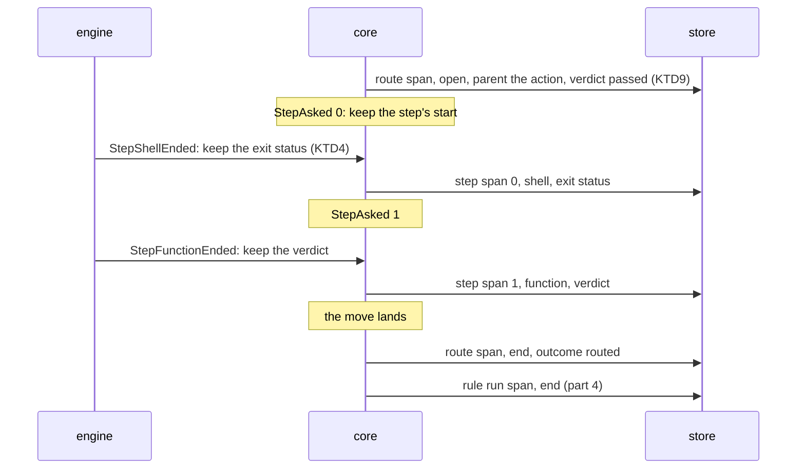

## Goal Capsule

- **Objective:** the core records the route a rule run chose as a span inside the action whose verdict chose it, and each of the route's shell and function steps as a span inside the route.
- **Parent:** #343, part 3 of 4. Read it only for a question this part does not answer.
- **Open blockers:** none.
- **Authority:** the Product Contract's requirements and Key Decisions win on behaviour; the KTDs win on mechanism; units override neither.

## Builds on

Already on main when this part starts; read the code, not these parts' files.

- Part 1 (U1): the action, route and step span records with their work detail, outcome, ids and parents, and the SQLite tables and writes that keep them, a route's first end included.

## Product Contract

### Summary

The route's span opens at `RouteChosen` and ends at `RunReleased`, before the rule run's end; each shell or function step's span is recorded at its `StepEnded`, with the exit status or verdict the core kept from the engine's input.

### Context

The route links a verdict to what followed it and what that cost. This part builds some of R11, which part 4 completes:

**The spans**

- R11. When an action's verdict leads to a route, the route is a span inside the action, with the verdict that chose it, its start and its end; each shell or function step of the route is a span inside it, with its name, its kind, its outcome, its start, its end and the crew process that ran it.

In the text copied from #343, "part 1", "part 2" and "part 4", and their KTDs, name parts of #315, already on main, not this split's parts.

### Key Decisions

- **Spans in a tree, not flat records.** An issue holds rule runs, a rule run holds actions, an action holds the route its verdict chose, and a route holds its steps; later slices add subagents, model calls, tool calls and waits as children. Each span inherits its issue, rule and repository from its ancestors instead of repeating them. Governs R9, R10, R11. (session-settled: user-approved — chosen over one flat record per action that repeats the issue, rule and queue: the tree normalizes the dimensions and each later slice adds a span kind without redesigning the base)
- **Routes are spans.** The route links a verdict to what followed it, so the statistics tell how often an action ends in each route and what the actions that ended there cost. Governs R11. (session-settled: user-directed — chosen over recording route steps loose inside the rule run)
- **The process is recorded once, like a telemetry Resource, and is not a level of the tree.** One crew process works on many issues and one issue's runs span many processes, so every span points to the process that ran it. Governs R5, R10, R11. (session-settled: user-approved — chosen over issue → process → rule run: the relation is many-to-many)
- **Each kind's detail is its own type.** Session, shell, function and route spans each carry only their own fields, in the shape of a sealed interface. A field uses its zero value for "absent" only where zero is never a valid value. The one real absence, a session's unreported usage, is explicit. Governs R12, R13, R14. (session-settled: user-approved — chosen over one record type with optional fields for every kind)
- **Unreported usage is not zero.** A measure that will gain its own granularity lives in its own records: a session's tokens are records by model that exist only when the harness reported them, so a stopped session reads as not reported and a shell reads as 0. Governs R13, R14. (session-settled: user-approved — chosen over a nullable token column and over storing 0: zero would make failed sessions look free)
- **The core decides what to record, the engine writes it.** The core already knows the issue, its labels, the run's rule, action, bot, verdict and route, so it builds the records and emits commands; the engine executes them through the port, the way it executes journal records today. Crew's own time reaches the core with the fact the engine hands it, so the core keeps no clock. Harness-specific detail stays in the harness's adapter. Governs R7, R8, R9, R10, R11, R12, R16. (session-settled: user-approved — chosen over the engine assembling records on its own: the core keeps the decision pure and table-testable)

### Requirements

**What each kind adds**

- R13. A shell span, action or step, adds its exit status. Shell, function and route spans count 0 tokens.

### Key Flows

- F2. A session action ends and its route runs
  - **Trigger:** the harness's session for an action of a rule run exits.
  - **Steps:** the engine reads the session's usage and hands the core the fact that the session ended; the core decides the action's verdict and, besides its usual commands, emits the action's span with its kind's detail; when the verdict leads to a route, the route's span opens inside the action, each of its shell and function steps is a span inside it when it ends, and the route's span closes when its last step ends; the engine writes every record through the port, and a failed write becomes a warning.
  - **Covered by:** R3, R10, R11, R12, R14

### Acceptance Examples

- AE5. **Covers R11, R13.** Given an action whose verdict leads to a route with a shell step that exits 0 and a function step, the action's span holds the route's span with the verdict that chose it, and the route's span holds the two steps' spans, the shell one with exit status 0; the route and its steps count 0 tokens.

### Scope Boundaries

- Each action's span is part 2; the engine's end-to-end test and the docs are part 4.
- Tracker steps of a route (a comment, a label move, a close) are later slices of #315, not this work: a tracker step records nothing.

### Sources / Research

Split from #343.

- `docs/plans/2026-10-09-2214-issue-342-plan.md` and `docs/solutions/design-patterns/rule-run-spans-differ-from-the-342-plan.md`: part 4's span, and where the shipped code differs from its plan (the halt only on `failed`, three causes of an open span, the first end kept by a conditional update gated on `RowsAffected`).

## Planning Contract

### Key Technical Decisions

- KTD2. **A span is written no later than its first child.** That rule decides when each kind is written:
  - an action's span is written once, at its `ActionEnded`, with its start and end: its only child, the route, comes after it;
  - a route's span is written open at its `RouteChosen`, before any step, and again with its end at `RunReleased`, before the rule run's end;
  - a step's span is written once, at its `StepEnded`.

  Like the rule run span, every record carries the whole span, and the store keeps the first end (part 4's KTD5). R10 asks for each action that ends, so an action still running when crew is killed leaves no span. Its rule run span stays open, as AE11 already says. The README names this beside part 4's three causes of an open span. Records are emitted from the live handlers in `internal/core/runs.go` and `internal/core/steps.go` only, after the event is applied. A replayed journal folds `History` and records nothing. Governs R10, R11, F2.
- KTD3. **The core keeps the start of each action and step it runs, beside the run.** While it records statistics, the held run keeps, by action name, the time crew asked for each action (`ActionSessionAsked`, `ActionShellAsked`, `ActionFunctionAsked`, `ActionReturnAsked`), and by step index the time of each `StepAsked`, the event's own time. Keyed starts matter: one decision can end an action and then end the next unasked, and a skipped step can follow a step that ran, so a single "current start" would hand one span another's start. An action or step that ends without being asked starts and ends at its end's time. That covers:
  - an action a halt kept from starting;
  - the action at the cursor when its workspace failed (`CauseWorkspace`, `internal/crew/fact.go`);
  - a prompt or text parameter that did not render;
  - a question action;
  - a skipped step, or a function step whose text parameters did not render.

  The run aggregate drops these starts: `InShell.Started` and `InFunction.Started` become `Finished`, and `RoutingPhase` keeps no step time. Keeping them on `heldRun`, as part 4 keeps `halt`, changes no snapshot and no journal line. Governs R10, R11.
- KTD4. **A step's exit status and returned verdict are taken from the engine's input, before the run decides.** `StepEnded` carries neither: `judgeStep` and `judgeFunctionStep` (`internal/crew/routing.go`) keep only a reason. When the core receives `StepShellEnded` or `StepFunctionEnded` (`runInput`, `internal/core/runs.go`), it keeps the outcome's `Status` or `Verdict` on the held run, by step index. Only the `StepEnded` of that index reads it. A later input for the same index replaces it. One the run refuses (`awaitsStep`), such as a late input after the step settled, is never read, since that step's span is already written and no route runs twice. An action's come from the run itself at `ActionEnded`: `ActionRun.Shell()` and `ActionRun.Function()`. Adding them to `StepEnded` would change the journal's version 3 wire format (`internal/adapter/jsonl`) for a value only statistics read. Governs R13.
- KTD5. **Each kind's outcome says how it ended, and an action's outcome carries its halt.** One outcome type serves action and step spans:

  | Outcome | Action | Step |
  |---|---|---|
  | `succeeded` | `EndSucceeded` | `StepRan` |
  | `failed` | `EndFailed` with any other cause | `StepFailed` |
  | `stopped` | `EndFailed` with `CauseStopped` | `StepStopped` |
  | `stopped_before_start` | `EndFailed` with `CauseStoppedBeforeStart` | `StepSkipped` |
  | `run_time_limit` | `EndFailed` with `CauseTimeUp` | none |

  This is the halt answer each new kind needs (`docs/solutions/design-patterns/rule-run-spans-differ-from-the-342-plan.md`): a halt chose an action's or step's end exactly when its outcome is one of the last three. Once crew's stop reached the run, a session that ends, even on its own, is `stopped`: `judgeSession` (`internal/crew/verdict.go`) gives `CauseStopped` whatever the harness said. A session that ends on its own after the run time is up keeps its own outcome. When its verdict leads to a next action, the time limit keeps that action from starting (`run_time_limit`) and sends the run through `failed`. A route's outcome is the rule run's, from `outcome` in `internal/core/statistics.go` (`routed`, `route_dropped`, `route_given_up`). The halt that sent the run through `failed` stays on the rule run span alone. Governs R10, R11, AE6.
- KTD9. **A route hangs from the action whose verdict chose it, when that action ran in this run, and from the rule run otherwise.** `RouteChosen.Action` names the action at the cursor. A rule without actions names none. A run of its continued run's passed route alone (`StartPassedRoute`) names an action that is `DoneInEarlierRun`, whose span belongs to the earlier run. In both, the route's parent is the rule run, and its verdict is none. The test is the named action's state in this run, `Finished`, not whether a name is given. Otherwise the verdict is the action's `Finished.Verdict`, `passed` included when the action went on past the last action. Governs R11.

### High-Level Technical Design

The records one run writes, in the writer's order, for a route with a shell step, a function step and a move, chosen by a session action's verdict `passed` (KTD2):

### Assumptions

These are unconfirmed bets made while planning, with nobody to ask. Review them in the pull request.

- An action a halt kept from starting, and a step that never ran, are spans of no length with their halt as outcome, so a count of stops sees them.
- A route's verdict is the verdict of the action that chose it, also when crew's stop forced the route to `failed`. The rule run's halt says the stop chose it.
- A route's time includes its tracker steps, which are not spans in this part.
- The built-in `question` and `answered` rules record their actions and routes like any rule.

### Deferred to Implementation

- How the held run keeps its starts, statuses and verdicts, a small struct or maps, as long as it is empty without statistics.

### Sequencing

U3 alone: keep a step's exit status or verdict from the engine's input, record the route's open, each step's span, then the route's end before the rule run's.

## Implementation Units

### U3. The core records the route's span and its steps' spans

**Goal:** the core records the route a run chose as a span inside the action that chose it, and each of its shell and function steps as a span inside it.

**Requirements:** R11, R13, F2, AE5 (KTD2, KTD3, KTD4, KTD5, KTD9).

**Dependencies:** U1.

**Files:**
- Modify `internal/core/statistics.go` (builders of the route and step spans).
- Modify `internal/core/runs.go` (`runInput` keeps a step's exit status or verdict from `StepShellEnded` and `StepFunctionEnded` before deciding; `on`, at `RunReleased`, records the route's end before the rule run's end).
- Modify `internal/core/steps.go` (`onRoute` records the route's open on `RouteChosen`, keeps a step's start on `StepAsked` and records a shell or function step's span on `StepEnded`).
- Test `internal/core/statistics_test.go`.

**Approach:**
- A step's kind and name come from the route's `StepPlan` (`StepShell` and `Shell`, `StepFunction` and `Function`); a tracker step records nothing.
- The function step's registered name comes from the rule's route definition (`FunctionStep.Function.Function`, `internal/crew/route.go`).
- The route's end reads the released run's phase, as `spanEnded` does, and is recorded only when the run chose a route.

**Patterns to follow:** `keepHalt` on `RouteChosen` in `internal/core/steps.go`; `outcome` in `internal/core/statistics.go`.

**Test scenarios:**
- Covers AE5. A session whose verdict leads to a route with a shell step that exits 0, a function step that returns `passed` and a move records, in order: the route's open with the action's span as parent and the verdict, the shell step span with exit status 0, the function step span, then the route's end with outcome `routed`, before the rule run's end.
- A shell step that exits 2 records outcome `failed` and exit status 2.
- A shell step crew stopped while it ran records outcome `stopped` with no exit status.
- A step a stop skipped records outcome `stopped_before_start`, starting and ending at once, not at the start of the step that ran before it.
- A route that runs the same shell action in two steps records two step spans, by index.
- A `StepShellEnded` the run refuses, as its step already settled, changes no span.
- A function step whose text parameters do not render records outcome `failed` and starts at its end.
- A route with only tracker steps records its open and its end, and no step span.
- A route whose final move is dropped ends with outcome `route_dropped`, and one whose final move is given up with `route_given_up`.
- A rule without actions records its route with the rule run as parent and no verdict. So does a run of its continued run's passed route alone.
- A run whose take does not land records no route span.
- A run that waits for its pull request lookup before its first step opens its route at `RouteChosen` and starts its first step at `StepAsked`.
- A replayed journal records no route or step span.

**Verification:** the core's tests pass with no clock or I/O, and every existing core test passes unchanged.

## Verification Contract

| Gate | Command | Applies to |
|---|---|---|
| Format | `gofmt -l cmd internal tools` prints nothing | every unit |
| Vet | `go vet ./...` | every unit |
| Lint and layering | `go run github.com/golangci/golangci-lint/v2/cmd/golangci-lint@v2.14.0 run` | every unit |
| Tests | `go test -race ./...` | every unit |
| Coverage floor | `go test -race -covermode=atomic -coverpkg=./... -coverprofile=coverage.out ./...`, then `go run github.com/vladopajic/go-test-coverage/v2@v2.19.0 --config=.testcoverage.yml` (total at least 90%) | before the pull request |
| Module tidy | `go mod tidy` changes nothing | before the pull request |
| Vulnerabilities | `go tool govulncheck ./...` | before the pull request |

## Definition of Done

- Every unit's Verification holds, and every gate above passes.
- Code from abandoned approaches is removed from the diff.

## Scope Boundaries (planning)

### Deferred to Follow-Up Work

- Tracker steps as spans, session identity, model calls, subagents, tool calls and the prompt catalog (later slices of #315).

### Considered and not built

- **Adding the exit status and verdict to `StepEnded`.** It changes the journal's wire format for a value only statistics read (KTD4). Revisit if a view needs a step's status.
- **Keeping starts in `ActionRun` and `RoutingPhase`.** It changes run snapshots and journal-restored state for data no run decision reads (KTD3).

<!-- cw-split-ce-plan: part of #343 -->

<!-- publish-split: part 3 of #343 -->

