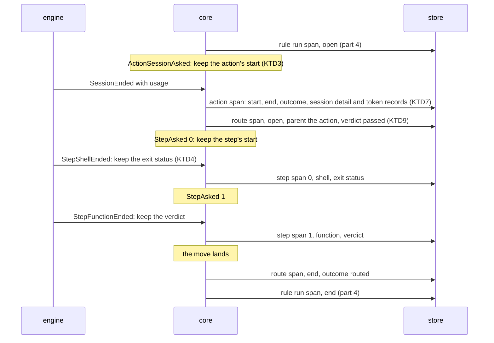

## Goal Capsule

- **Objective:** a running crew is shown to write the whole tree of action, route and step spans in order with its other records, and the README, CONCEPTS.md and AGENTS.md describe those spans.
- **Parent:** #343, part 4 of 4. Read it only for a question this part does not answer.
- **Open blockers:** none.
- **Authority:** the Product Contract's requirements and Key Decisions win on behaviour; the KTDs win on mechanism; units override neither.

## Builds on

Already on main when this part starts; read the code, not these parts' files.

- Part 2 (U2): each action's span, recorded by the core when the action ends, with its session, shell, function, question or check detail.
- Part 3 (U3): the route's span inside the action that chose it, and each shell and function step's span inside the route.

## Product Contract

### Summary

An engine test under `synctest` that a crew developing an issue writes the action, route and step spans in their place among its records, and warns for each lost one; then the docs of what crew records.

### Context

Parts 1 to 3 built the spans; this part proves them end to end and makes the docs true. Parts 1 to 3 completed these requirements, which U5 documents:

**What each kind adds**

- R13. A shell span, action or step, adds its exit status. Shell, function and route spans count 0 tokens.
- R14. A session whose harness reported no usage, such as one crew stopped or one that crashed, has no token records, and its tokens read as not reported.
- R15. The store holds no prompt text, tool arguments or session output; the prompt template is stored only as its hash.

In the text copied from #343, "part 1", "part 2" and "part 4", and their KTDs, name parts of #315, already on main, not this split's parts.

### Key Decisions

- **Spans in a tree, not flat records.** An issue holds rule runs, a rule run holds actions, an action holds the route its verdict chose, and a route holds its steps; later slices add subagents, model calls, tool calls and waits as children. Each span inherits its issue, rule and repository from its ancestors instead of repeating them. Governs R9, R10, R11. (session-settled: user-approved — chosen over one flat record per action that repeats the issue, rule and queue: the tree normalizes the dimensions and each later slice adds a span kind without redesigning the base)
- **Routes are spans.** The route links a verdict to what followed it, so the statistics tell how often an action ends in each route and what the actions that ended there cost. Governs R11. (session-settled: user-directed — chosen over recording route steps loose inside the rule run)
- **The process is recorded once, like a telemetry Resource, and is not a level of the tree.** One crew process works on many issues and one issue's runs span many processes, so every span points to the process that ran it. Governs R5, R10, R11. (session-settled: user-approved — chosen over issue → process → rule run: the relation is many-to-many)
- **Each kind's detail is its own type.** Session, shell, function and route spans each carry only their own fields, in the shape of a sealed interface. A field uses its zero value for "absent" only where zero is never a valid value. The one real absence, a session's unreported usage, is explicit. Governs R12, R13, R14. (session-settled: user-approved — chosen over one record type with optional fields for every kind)
- **Unreported usage is not zero.** A measure that will gain its own granularity lives in its own records: a session's tokens are records by model that exist only when the harness reported them, so a stopped session reads as not reported and a shell reads as 0. Governs R13, R14. (session-settled: user-approved — chosen over a nullable token column and over storing 0: zero would make failed sessions look free)
- **The core decides what to record, the engine writes it.** The core already knows the issue, its labels, the run's rule, action, bot, verdict and route, so it builds the records and emits commands; the engine executes them through the port, the way it executes journal records today. Crew's own time reaches the core with the fact the engine hands it, so the core keeps no clock. Harness-specific detail stays in the harness's adapter. Governs R7, R8, R9, R10, R11, R12, R16. (session-settled: user-approved — chosen over the engine assembling records on its own: the core keeps the decision pure and table-testable)
- **Tokens, no money.** The statistics count tokens and time; cost is not stored. Governs R12.

### Requirements

**The spans**

- R10. Each action that ends is a span inside its rule run, with its name, its kind (session, shell or function), its outcome, its start, its end and the crew process that ran it.
- R11. When an action's verdict leads to a route, the route is a span inside the action, with the verdict that chose it, its start and its end; each shell or function step of the route is a span inside it, with its name, its kind, its outcome, its start, its end and the crew process that ran it.

**What each kind adds**

- R12. A session span adds its agent, harness and bot, a hash of its action's prompt template, its turns, and the tokens the harness reported for each model: input, output, cache read and cache write.

### Key Flows

- F2. A session action ends and its route runs
  - **Trigger:** the harness's session for an action of a rule run exits.
  - **Steps:** the engine reads the session's usage and hands the core the fact that the session ended; the core decides the action's verdict and, besides its usual commands, emits the action's span with its kind's detail; when the verdict leads to a route, the route's span opens inside the action, each of its shell and function steps is a span inside it when it ends, and the route's span closes when its last step ends; the engine writes every record through the port, and a failed write becomes a warning.
  - **Covered by:** R3, R10, R11, R12, R14
- F3. A rule run's life across a restart
  - **Trigger:** a rule takes an issue, and crew restarts before the run ends.
  - **Steps:** the rule run's span is written when the run starts, while the first process runs; the restarted crew records a new process; the actions and route steps that end after the restart point to the new process; the rule run's span is completed when the run ends.
  - **Covered by:** R5, R9, R10, R11

### Scope Boundaries

- Tracker steps of a route (a comment, a label move, a close), session identity, model calls, subagents, tool calls and the prompt catalog are later slices of #315, not this part.
- Cost in money is not stored. The live view and the status comment keep showing it as they do today.
- Part 2 documents what crew records in the README; this part keeps it true for action, route and step spans and their tokens.

### Dependencies / Assumptions

- The core already reads the action, the bot and the outcome where an action ends, and the engine already executes recorded run events from its loop in order.

### Sources / Research

Split from #343.

- `internal/engine/exec.go`.
- `docs/plans/2026-10-09-2214-issue-342-plan.md` and `docs/solutions/design-patterns/rule-run-spans-differ-from-the-342-plan.md`: part 4's span, and where the shipped code differs from its plan (the halt only on `failed`, three causes of an open span, the first end kept by a conditional update gated on `RowsAffected`).

## Planning Contract

### Key Technical Decisions

- KTD2. **A span is written no later than its first child.** That rule decides when each kind is written:
  - an action's span is written once, at its `ActionEnded`, with its start and end: its only child, the route, comes after it;
  - a route's span is written open at its `RouteChosen`, before any step, and again with its end at `RunReleased`, before the rule run's end;
  - a step's span is written once, at its `StepEnded`.

  Like the rule run span, every record carries the whole span, and the store keeps the first end (part 4's KTD5). R10 asks for each action that ends, so an action still running when crew is killed leaves no span. Its rule run span stays open, as AE11 already says. The README names this beside part 4's three causes of an open span. Records are emitted from the live handlers in `internal/core/runs.go` and `internal/core/steps.go` only, after the event is applied. A replayed journal folds `History` and records nothing. Governs R10, R11, F2.
- KTD5. **Each kind's outcome says how it ended, and an action's outcome carries its halt.** One outcome type serves action and step spans:

  | Outcome | Action | Step |
  |---|---|---|
  | `succeeded` | `EndSucceeded` | `StepRan` |
  | `failed` | `EndFailed` with any other cause | `StepFailed` |
  | `stopped` | `EndFailed` with `CauseStopped` | `StepStopped` |
  | `stopped_before_start` | `EndFailed` with `CauseStoppedBeforeStart` | `StepSkipped` |
  | `run_time_limit` | `EndFailed` with `CauseTimeUp` | none |

  This is the halt answer each new kind needs (`docs/solutions/design-patterns/rule-run-spans-differ-from-the-342-plan.md`): a halt chose an action's or step's end exactly when its outcome is one of the last three. Once crew's stop reached the run, a session that ends, even on its own, is `stopped`: `judgeSession` (`internal/crew/verdict.go`) gives `CauseStopped` whatever the harness said. A session that ends on its own after the run time is up keeps its own outcome. When its verdict leads to a next action, the time limit keeps that action from starting (`run_time_limit`) and sends the run through `failed`. A route's outcome is the rule run's, from `outcome` in `internal/core/statistics.go` (`routed`, `route_dropped`, `route_given_up`). The halt that sent the run through `failed` stays on the rule run span alone. Governs R10, R11, AE6.
- KTD7. **Three new record types, each kind's detail a sealed interface, and tokens absent until reported.** `crew.ActionSpan`, `crew.RouteSpan` and `crew.StepSpan` join `Statistic`. An action or step span holds its work's detail as one of `SessionWork`, `ShellWork`, `FunctionWork`, `QuestionWork` or `CheckWork`; a step only ever holds the shell or function ones. Records compute their own ids and parent ids (KTD1, KTD9), so the store and the tests share one rule. `SessionWork` keeps its tokens optional:
  - when the harness reported usage by model (`Usage.ByModel`), one record per model;
  - when it reported only a sum (`Usage.Tokens` with no `ByModel`, as Codex does), one record with no model name;
  - when it reported no tokens, none, which reads as not reported (R14), as a stopped or crashed session does (`port.UsageReporter`).

  Turns stay `Optional[int]`, as `Usage.Turns` is. `SessionWork` also keeps when the session started, from `ActionEnded.SessionStarted`, none when it never started. A workspace that failed, a session that could not start, a prompt that did not render or a halt all leave no token records, so they read as not reported, as R14 says. The session start lets a sum tell the sessions that ran and reported nothing from the ones that never ran. It is stored now because rows written without it could not get it later. A stopped session is not always one with no tokens: a Claude Code session stopped after an earlier result reports what it had. AE6 is a stopped session whose harness reported nothing. The records also carry the rule run's rule and issue, for crew's warning words only: the store writes neither, since the tree gives them (Key Decisions). Governs R12, R13, R14.

### High-Level Technical Design

The records one run writes, in the writer's order, for a session action whose verdict leads to `passed`, a route with a shell step, a function step and a move (KTD2):

### Assumptions

These are unconfirmed bets made while planning, with nobody to ask. Review them in the pull request.

- A Codex session reports a token sum with no model. It gets one token record with an empty model name, so its tokens count as reported. Only a session with no token usage at all reads as not reported, and its session start tells whether it ran.
- An action still running when crew is killed leaves no span, so a long session cut short that way is missing from a sum of tokens and from the count of sessions that did not report. Its rule run span stays open, which shows the run was cut short.

### Sequencing

U4, then U5: the end-to-end test first, then the docs it confirms.

## Implementation Units

### U4. A running crew records the whole tree

**Goal:** the engine writes every new span through the configured store, in order with the other records.

**Requirements:** R10, R11, R12, F2 (KTD2).

**Dependencies:** U2, U3.

**Files:**
- Test `internal/engine/statistics_test.go`.

**Approach:** the writer, the `RecordStatistic` command and the `StatisticFailed` path are generic over `crew.Statistic`, so no engine code should change. If one has to, keep it to the writer's existing path. `developedRun` gains the action, route and step records in their place.

**Patterns to follow:** `TestRunRecordsTheProcessTheRepositoryTheIssueItsMovesAndItsRunsSpanInOrder` and `TestAE8AStoreThatCannotBeWrittenIsWarnedAboutAndTheRunGoesOn`, under `synctest`, with `recordingConfig` and `fake.NewStatistics`.

**Test scenarios:**
- A crew that develops issue 1 with a scripted session that reports usage records, in order: the process, the repository, the sighting, the rule run's open, the take's move, the action span with its session detail and tokens, the route's open, the route's move, the route's end, then the rule run's end.
- A store whose records fail warns once for each lost action, route and step record, and the run ends as it would without statistics.

**Verification:** the engine's tests pass under `synctest` with no leaked goroutine.

### U5. The README, CONCEPTS.md and AGENTS.md say what crew records

**Goal:** the docs describe action, route and step spans, what each kind holds, when each is written and what reads as not reported.

**Requirements:** R10 to R15 (Scope Boundaries: part 2's README section stays true).

**Dependencies:** U1, U4.

**Files:**
- Modify `README.md` (`## Statistics`: a paragraph on action, route and step spans: their outcomes, each kind's detail, tokens by model or as one sum with no model, a session with no token records as not reported, with its session start telling a session that ran from one that never did, a stopped session that may still report what it used, the prompt kept only as a hash and no reason or output stored, an action still running when crew is killed leaving no span).
- Modify `CONCEPTS.md` (`### Statistics store`: the tree below the rule run, and each kind's detail).
- Modify `AGENTS.md` (the `internal/crew` bullet's `Statistic` variants, the `internal/core` statistics sentence, and the `sqlite` adapter's tables).

**Approach:** name the outcomes in users' words (KTD5), and say which spans are written at their end only and which open first (KTD2).

**Test expectation:** none -- documentation only.

**Verification:** each doc's statement matches the behaviour U1 to U4 test.

## Verification Contract

| Gate | Command | Applies to |
|---|---|---|
| Format | `gofmt -l cmd internal tools` prints nothing | every unit |
| Vet | `go vet ./...` | every unit |
| Lint and layering | `go run github.com/golangci/golangci-lint/v2/cmd/golangci-lint@v2.14.0 run` | every unit |
| Tests | `go test -race ./...` | every unit |
| Coverage floor | `go test -race -covermode=atomic -coverpkg=./... -coverprofile=coverage.out ./...`, then `go run github.com/vladopajic/go-test-coverage/v2@v2.19.0 --config=.testcoverage.yml` (total at least 90%) | before the pull request |
| Module tidy | `go mod tidy` changes nothing | before the pull request |
| Vulnerabilities | `go tool govulncheck ./...` | before the pull request |

## Definition of Done

- Every unit's Verification holds, and every gate above passes.
- A crew run against a fake tracker records, under its rule run span, each action's span, the route's span inside the action that chose it, and each shell and function step's span inside the route.
- `README.md`, `CONCEPTS.md` and `AGENTS.md` describe the new spans in the same pull request.
- Code from abandoned approaches is removed from the diff.

## Scope Boundaries (planning)

### Deferred to Follow-Up Work

- Tracker steps as spans, session identity, model calls, subagents, tool calls and the prompt catalog (later slices of #315).
- Queries or a report over the spans: this part writes them only.

<!-- cw-split-ce-plan: part of #343 -->

<!-- publish-split: part 4 of #343 -->

