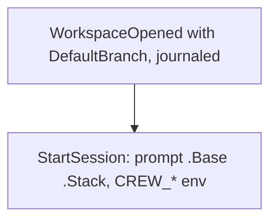

## Goal Capsule

- **Objective:** a session's prompt can read the run's base branch and its stack, rendered the same way when crew checks the prompt and when it starts the session.
- **Parent:** #425, part 2 of 8. Read it only for a question this part does not answer.
- **Open blockers:** none.

## Builds on

Already on main when this part starts; read the code, not these parts' files.

- Part 1 (U1): the `crew` types: `Stack`, `RunTaken.Stack` and `RuleRun`'s stack, `OpenedWorkspace.DefaultBranch`.

## Product Contract

### Summary

Adds `.Base` and `.Stack` to a session prompt's template data. `Prompt.Render` takes the run's base and stack at every call site, and `ParsePrompt` checks a prompt against both a stacked and an unstacked sample.

### Context

A stacked session must know which branch it is on and which blocker and pull request sit below it, so its prompt can open its pull request on that base. Its unit builds the prompt half of R8, which part 7 completes with the environment variables.

### Key Decisions

- **crew makes the workspace from the base when it takes the issue.** Governs R7, R8. (session-settled: user-approved — chosen over the issue's original design, where an action writes the base into `.crew-branch-base.local` and crew rebases between actions: deciding once at the take avoids a conflict mid-run and a force push.)

### Scope Boundaries

- Every run is unstacked until part 6 takes stacked issues, and `.Base` stays empty until part 4 reports the default branch; this part only carries what the run holds.
- The README documents the prompt fields in part 8.
- The prompt that opens the pull request on the run's base and links it into a stack is the repository's configuration; this plan sets no wording for it.

### Outstanding Questions

**Deferred to Planning**

- The names and shapes of the rule's stacking key, the prompt fields and the environment variables of R8.

Its questions deferred to planning are answered by [...] KTD8 and KTD9 (the key, the prompt fields and the variables).

### Sources / Research

- Split from #425.

## Planning Contract

### Key Technical Decisions

- KTD7. **`Workspace.Create` takes the base branch, and every workspace reports origin's default branch.** An empty base means origin's default branch, as today. The git adapter fetches `refs/heads/<base>` from origin into its remote-tracking ref and adds the worktree with `--no-track` from it (R7). It first checks the branch name with `git check-ref-format --branch` and refuses control characters (`docs/solutions/runtime-errors/nul-in-gh-argument-freezes-status-comment.md`). `Create` and `Reopen` both report the default branch's name, which reaches the run as its opened workspace's `DefaultBranch` and is journaled with `WorkspaceOpened`. `Reopen` still fetches nothing and changes nothing (`docs/solutions/logic-errors/stale-workspace-claim-drops-another-actions-resume-point.md`). A run's base is its stack's branch when stacked and the default branch otherwise (R8). The core never resolves the default branch itself.
- KTD8. **Sessions read the stack as prompt data and as environment variables. Shell actions and route shell steps read it as environment variables.**
  - **Prompt data:** a session prompt's template data gains `.Base` and `.Stack`. `.Stack` has `Stacked`, `Blocker.Ref`, `Blocker.URL`, `PullRequest.Ref`, `PullRequest.URL` and `Branch`, all empty when the run is unstacked.
  - **Rendering:** `Prompt.Render` takes the run's stack and base next to the issue at every call site, so the render that checks a prompt when the session is asked for and the render that starts it produce the same text. `ParsePrompt` renders both a stacked and an unstacked sample, so a typo inside `{{if .Stack.Stacked}}` fails at config load.
  - **Environment:** `CREW_BASE_BRANCH`, `CREW_BLOCKER_REF`, `CREW_BLOCKER_URL`, `CREW_BLOCKER_PR_REF` and `CREW_BLOCKER_PR_URL`; the last four are empty when the run is unstacked. Codex gets them only through the process environment (`docs/solutions/security-issues/session-environment-values-in-codex-command-line.md`).
  - **Left out:** function parameters and comment templates get neither, since R8 names sessions and shell actions only.

### High-Level Technical Design

### Implementation Constraints

- Core stays pure and table-tested. Engine tests run under `testing/synctest`. Fakes come from `internal/fake`, and tests build their registry with `registry.New`.

### Sequencing

U3 is the only unit. Part 6 builds on it.

## Implementation Units

### U3. Prompt data for the base and the stack

- **Goal:** a session's prompt can read the run's base and stack.
- **Requirements:** R8; KTD8.
- **Dependencies:** U1.
- **Files:** `internal/crew/prompt.go`, `internal/crew/prompt_test.go`, `internal/crew/decide.go`, `internal/core/runs.go`, and the other `Render` call sites the compiler names.
- **Approach:** `Render` takes the run's prompt data next to the issue: the base and the stack. `ParsePrompt` renders a stacked and an unstacked sample. Every call site passes the held run's stack and its base (KTD7). Function parameter templates and comment templates keep their data.
- **Patterns to follow:** `promptIssue` and `sampleIssue` in `prompt.go`.
- **Test scenarios:**
  - A prompt using `{{.Base}}` renders the base it is given.
  - `{{if .Stack.Stacked}}{{.Stack.PullRequest.URL}}{{end}}` renders the URL for a stacked run and nothing for an unstacked one.
  - A prompt with a typo inside `{{if .Stack.Stacked}}` fails `ParsePrompt`, naming the action.
  - `{{.Stack.Blocker.Number}}`, a field that does not exist, fails `ParsePrompt`.
  - The prompt crew checks before asking for the session and the prompt it starts the session with are equal for a stacked run.
- **Verification:** crew and core tests pass, and every existing prompt fixture renders as before.

## Scope Boundaries (planning additions)

- **No `.Base` or `.Stack` in function parameters or comment templates (KTD8).**

## Verification Contract

| Gate | Command | Applies to |
|---|---|---|
| Tests | `go test -race ./...` | every unit |
| Format | `gofmt -l cmd internal tools` prints nothing | every unit |
| Vet | `go vet ./...` | every unit |
| Lint and layering | `go run github.com/golangci/golangci-lint/v2/cmd/golangci-lint@v2.14.0 run` | every unit |
| Coverage | `go test -race -covermode=atomic -coverpkg=./... -coverprofile=coverage.out ./...`, then `go run github.com/vladopajic/go-test-coverage/v2@v2.19.0 --config=.testcoverage.yml` (total at least 90%) | before shipping |
| Vulnerabilities | `go tool govulncheck ./...` | before shipping |

## Definition of Done

- A rule without `stacking` behaves exactly as before. The existing scheduler, resume and journal tests pass unchanged.
- No dead-end code from abandoned approaches is left in the diff.

<!-- cw-split-ce-plan: part of #425 -->

<!-- publish-split: part 2 of #425 -->

