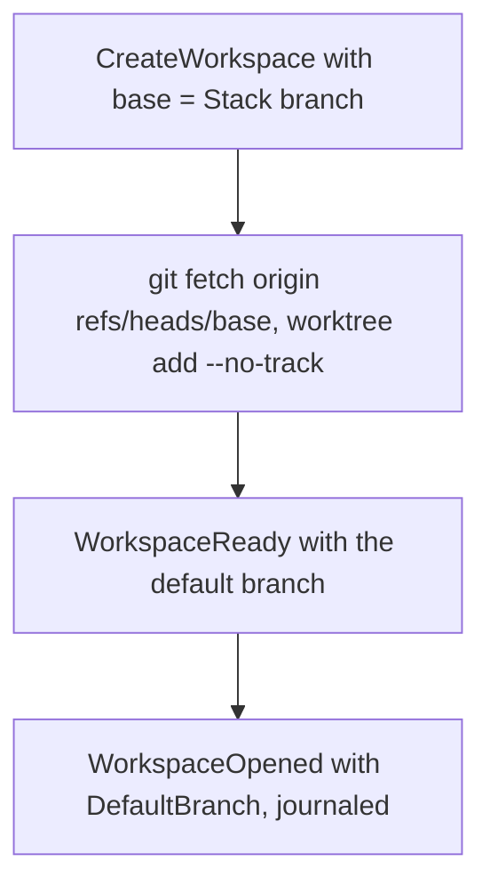

## Goal Capsule

- **Objective:** `Workspace.Create` makes a worktree from a given base branch, an empty base meaning origin's default branch as today, and every workspace reports origin's default branch to the run.
- **Parent:** #425, part 4 of 8. Read it only for a question this part does not answer.
- **Open blockers:** none.

## Builds on

Already on main when this part starts; read the code, not these parts' files.

- Part 1 (U1): `OpenedWorkspace.DefaultBranch`, which this part fills.

## Product Contract

### Summary

`Workspace.Create` takes a base, and the git adapter fetches it and adds the worktree from it with `--no-track`. `Create` and `Reopen` report the default branch, which reaches the run through `WorkspaceReady` and `WorkspaceOpened`. Every caller passes an empty base until part 6 takes stacked issues.

### Context

A stacked issue's workspace must start from the latest commit of its blocker's pull request branch, and an unstacked run's base is the default branch, which only the workspace knows. Its unit builds some of R7, which part 6 completes, and of R8, which part 7 completes.

### Key Decisions

- **crew makes the workspace from the base when it takes the issue.** Governs R7, R8. (session-settled: user-approved — chosen over the issue's original design, where an action writes the base into `.crew-branch-base.local` and crew rebases between actions: deciding once at the take avoids a conflict mid-run and a force push.)

### Acceptance Examples

- AE2. **Covers R2, R5, R7.** Given a rule with stacking on and an issue blocked only by #A, whose run ended with its pull request open and nothing stacked on it, the rule takes the issue with a workspace made from #A's pull request branch.

### Scope Boundaries

- The take that asks for a base is part 6's; the journal key for the default branch is part 5's.
- The issue's file-based design is dropped: no `.crew-branch-base.local`, no `.crew-stack-pr-from.local`, no `.crew/running-data/`, and no rebase between actions.
- A resumed stacked run reopens its workspace as crew does today; no new behaviour on resume. When the blocker merged before the resume, the run's branch still holds the blocker's original commits and its pull request conflicts with `main`; a person rebases it onto `main`, leaving those commits out.

### Sources / Research

- Split from #425.
- `internal/adapter/git/workspace.go:87-97`: every workspace is made from origin's default branch; `internal/port/port.go:169`: `Create` takes no base.

## Planning Contract

### Key Technical Decisions

- KTD7. **`Workspace.Create` takes the base branch, and every workspace reports origin's default branch.** An empty base means origin's default branch, as today. The git adapter fetches `refs/heads/<base>` from origin into its remote-tracking ref and adds the worktree with `--no-track` from it (R7). It first checks the branch name with `git check-ref-format --branch` and refuses control characters (`docs/solutions/runtime-errors/nul-in-gh-argument-freezes-status-comment.md`). `Create` and `Reopen` both report the default branch's name, which reaches the run as its opened workspace's `DefaultBranch` and is journaled with `WorkspaceOpened`. `Reopen` still fetches nothing and changes nothing (`docs/solutions/logic-errors/stale-workspace-claim-drops-another-actions-resume-point.md`). A run's base is its stack's branch when stacked and the default branch otherwise (R8). The core never resolves the default branch itself.

### High-Level Technical Design

### Implementation Constraints

- Core stays pure and table-tested. Engine tests run under `testing/synctest`. Fakes come from `internal/fake`, and tests build their registry with `registry.New`.

### Sequencing

U6 is the only unit. Part 6 builds on it.

## Implementation Units

### U6. Workspace: create from a base and report the default branch

- **Goal:** a stacked run's worktree starts at the latest commit of the blocker's pull request branch, and every workspace reports the default branch.
- **Requirements:** R7, R8; KTD7.
- **Dependencies:** U1.
- **Files:** `internal/port/port.go`, `internal/adapter/git/workspace.go`, `internal/adapter/git/workspace_test.go`, `internal/fake/workspace.go`, `internal/engine/exec.go`, `internal/core/input.go`, `internal/engine` tests that create workspaces.
- **Approach:** `Workspace.Create` takes a base, where empty means the default branch. The git adapter checks the name, fetches that branch and adds the worktree from it with `--no-track`. `Space` carries the default branch's name, from `Create` and from `Reopen`. The fake records the base it was asked for and reports a default branch. `WorkspaceReady` carries it into `WorkspaceOpened`.
- **Patterns to follow:** `TestCreateFetchesThenAddsWorktreeFromOriginDefault`, and the real-git `newRemote`/`advance`/`checkFromLatest` tests in `workspace_test.go`.
- **Test scenarios:**
  - An empty base fetches the default branch, adds the worktree from it, and reports the default branch.
  - Covers AE2. With a base, the adapter fetches that branch and adds the worktree with `--no-track` from it. In a real repository, the worktree's HEAD is the branch's tip after the remote advanced it.
  - A base starting with `-` or holding a control character is refused before any git call.
  - A base origin does not have fails with git's stderr, and the engine turns it into `WorkspaceFailed`.
  - `Reopen` reports the default branch and runs no fetch, rebase or checkout.
- **Verification:** git adapter tests, real-git ones included, and engine tests pass.

## Risks & Dependencies

| Risk | Mitigation |
|---|---|
| The blocker's branch is deleted between the listing and the fetch, for example because its pull request merged. | The run fails through `failed` on the existing `WorkspaceFailed` path, which is visible on the issue. A U6 test row covers it. Considered and not built: Scope Boundaries. |

## Scope Boundaries (planning additions)

- **No fallback when the blocker's branch is gone at the fetch.** The failure is visible on the issue and rare, and a person moves the issue back. Evidence that it happens often would change this.

## Verification Contract

| Gate | Command | Applies to |
|---|---|---|
| Tests | `go test -race ./...` | every unit |
| Format | `gofmt -l cmd internal tools` prints nothing | every unit |
| Vet | `go vet ./...` | every unit |
| Lint and layering | `go run github.com/golangci/golangci-lint/v2/cmd/golangci-lint@v2.14.0 run` | every unit |
| Coverage | `go test -race -covermode=atomic -coverpkg=./... -coverprofile=coverage.out ./...`, then `go run github.com/vladopajic/go-test-coverage/v2@v2.19.0 --config=.testcoverage.yml` (total at least 90%) | before shipping |
| Vulnerabilities | `go tool govulncheck ./...` | before shipping |

## Definition of Done

- A rule without `stacking` behaves exactly as before. The existing scheduler, resume and journal tests pass unchanged.
- No dead-end code from abandoned approaches is left in the diff.

<!-- cw-split-ce-plan: part of #425 -->

<!-- publish-split: part 4 of #425 -->

