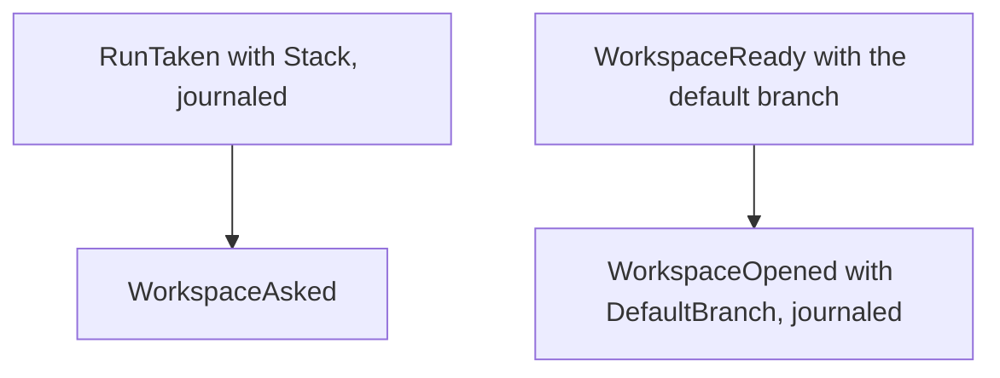

## Goal Capsule

- **Objective:** a replayed run journal keeps each run's stack and each opened workspace's default branch, still at version 3.
- **Parent:** #425, part 5 of 8. Read it only for a question this part does not answer.
- **Open blockers:** none.

## Builds on

Already on main when this part starts; read the code, not these parts' files.

- Part 1 (U1): `RunTaken.Stack` and `OpenedWorkspace.DefaultBranch`, which this part journals.

## Product Contract

### Summary

The `jsonl` journal writes an optional `stack` object on the taken line and an optional `default_branch` key on the workspace-opened line, and reads lines written before them as unstacked.

### Context

A restarted crew rebuilds its runs from the journal, so the stack a run was taken with and the default branch its workspace reported must survive a restart. Its unit builds some of R8, which part 7 completes.

### Key Decisions

- **crew makes the workspace from the base when it takes the issue.** Governs R7, R8. (session-settled: user-approved — chosen over the issue's original design, where an action writes the base into `.crew-branch-base.local` and crew rebases between actions: deciding once at the take avoids a conflict mid-run and a force push.)

### Scope Boundaries

- No run carries a stack until part 6, and no workspace reports a default branch until part 4; this part only writes and reads the keys.

### Sources / Research

- Split from #425.

## Planning Contract

### Key Technical Decisions

- KTD6. **Every take decides its stack anew, a continuing take included, and journals the decision on `RunTaken`.** `crew.RunTaken` gains an optional `Stack` with the blocker's ID, reference and URL, the pull request's reference and URL, and its branch. It is written as a key that is left out when empty on the version 3 line (`internal/adapter/jsonl/line.go`). A resumed run reopens its worktree as crew does today, as the Product Contract's scope requires. Its prompt and environment follow this take's decision. A formerly stacked issue whose blocker has closed is therefore taken unstacked, with the default branch as its base (R4). Its worktree still holds the blocker's original commits, which the scope leaves to a person to rebase. When a resumed run's worktree is missing, crew creates a new one from this take's stack branch, or from the default branch.
- KTD7. **`Workspace.Create` takes the base branch, and every workspace reports origin's default branch.** An empty base means origin's default branch, as today. The git adapter fetches `refs/heads/<base>` from origin into its remote-tracking ref and adds the worktree with `--no-track` from it (R7). It first checks the branch name with `git check-ref-format --branch` and refuses control characters (`docs/solutions/runtime-errors/nul-in-gh-argument-freezes-status-comment.md`). `Create` and `Reopen` both report the default branch's name, which reaches the run as its opened workspace's `DefaultBranch` and is journaled with `WorkspaceOpened`. `Reopen` still fetches nothing and changes nothing (`docs/solutions/logic-errors/stale-workspace-claim-drops-another-actions-resume-point.md`). A run's base is its stack's branch when stacked and the default branch otherwise (R8). The core never resolves the default branch itself.

### High-Level Technical Design

### Implementation Constraints

- The journal stays at version 3. New keys may be left out of a line, and older lines decode as unstacked.

### Sequencing

U8 is the only unit. Part 8 builds on it.

## Implementation Units

### U8. Journal: the run's stack and the default branch

- **Goal:** a replayed journal keeps each run's stack and each opened workspace's default branch.
- **Requirements:** R8; KTD6, KTD7.
- **Dependencies:** U1.
- **Files:** `internal/adapter/jsonl/line.go`, `internal/adapter/jsonl/encode.go`, `internal/adapter/jsonl/decode.go`, `internal/adapter/jsonl/journal_test.go`, `internal/adapter/jsonl/wire_test.go`.
- **Approach:** add a `stack` object to the taken line and a `default_branch` key to the workspace-opened line. Both are left out when empty, and the version stays 3.
- **Patterns to follow:** `takenLine` and `line.runTaken`, and the optional `start` and `questions` keys.
- **Test scenarios:**
  - A `RunTaken` with a stack round-trips through a line, and one without a stack writes no `stack` key.
  - A `WorkspaceOpened` with a default branch round-trips, and one without writes no `default_branch` key.
  - A version 3 line written before this change decodes as unstacked, with no default branch.
- **Verification:** the jsonl tests pass, and a journal from the previous release loads.

## Verification Contract

| Gate | Command | Applies to |
|---|---|---|
| Tests | `go test -race ./...` | every unit |
| Format | `gofmt -l cmd internal tools` prints nothing | every unit |
| Vet | `go vet ./...` | every unit |
| Lint and layering | `go run github.com/golangci/golangci-lint/v2/cmd/golangci-lint@v2.14.0 run` | every unit |
| Coverage | `go test -race -covermode=atomic -coverpkg=./... -coverprofile=coverage.out ./...`, then `go run github.com/vladopajic/go-test-coverage/v2@v2.19.0 --config=.testcoverage.yml` (total at least 90%) | before shipping |
| Vulnerabilities | `go tool govulncheck ./...` | before shipping |

## Definition of Done

- A rule without `stacking` behaves exactly as before. The existing scheduler, resume and journal tests pass unchanged.
- No dead-end code from abandoned approaches is left in the diff.

<!-- cw-split-ce-plan: part of #425 -->

<!-- publish-split: part 5 of #425 -->

