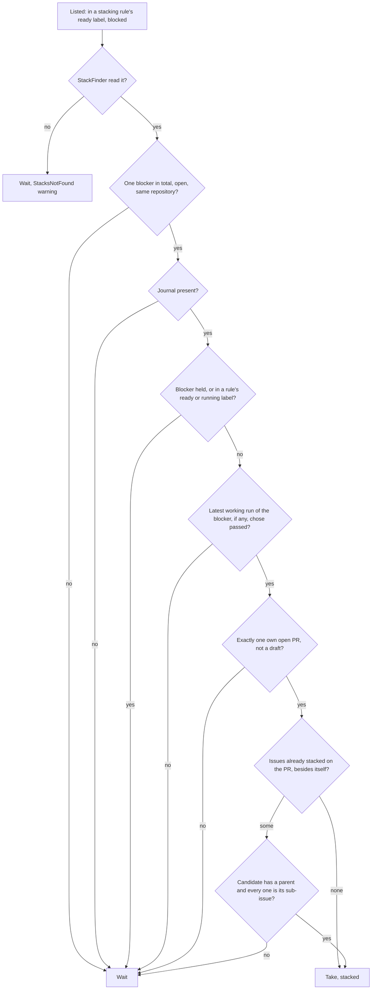
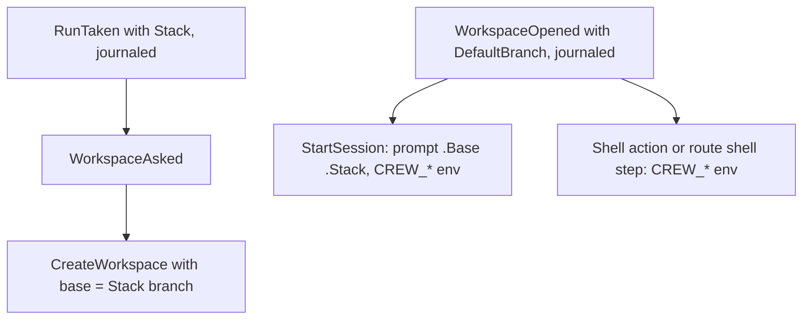

## Goal Capsule

- **Objective:** a rule with stacking on takes an eligible blocked issue, journals the stack it took it with, and asks for its workspace from the blocker's pull request branch; every other blocked issue waits as today.
- **Parent:** #425, part 6 of 8. Read it only for a question this part does not answer.
- **Open blockers:** none.

## Builds on

Already on main when this part starts; read the code, not these parts' files.

- Part 2 (U3): `Prompt.Render` takes the run's base and stack, and every call site passes the held run's.
- Part 4 (U6): `WorkspaceReady` carries the workspace's default branch into `WorkspaceOpened`, the base of an unstacked run, and `Workspace.Create` takes a base.

## Product Contract

### Summary

The core's take decision: one pure check in `takeWaiting` reads a blocked candidate's stack reading against the listing, the held runs and `History`, and takes it stacked only when R2, R5 and R6 hold. The take sets `RunTaken.Stack`, `CreateWorkspace` carries the stack's branch, and `StartSession` and `Script` carry the base and the stack.

### Context

Today crew never takes an issue an open issue blocks, so each part of a split waits for the review and merge of the part below it. This part decides when a blocked issue may start on its blocker's branch. It builds some of R1, which part 8 completes with the config key, and of R4 and R8, which part 7 completes by reading stacks during the listing and setting the environment. No rule can turn stacking on until part 8, and no issue carries a stack reading until part 7, so nothing changes on `main` yet.

### Key Decisions

- **crew checks the blocker's open pull request itself.** Governs R2, R3. (session-settled: user-directed — chosen over taking an issue when its blocker carries a given label, and over taking every blocked issue and letting the prompt give back the ones not ready: crew can read the pull request directly.)
- **Sub-issues of one parent may all stack on the same blocker's pull request; any other issue waits for the merge.** Governs R5, R6. (session-settled: user-directed — chosen over stacking each sibling on top of the one before it, which brings back the sibling walk-up, and over letting only the first issue stack in every case: `gh stack` restacks siblings easily, and only issues of one parent are meant to land together.)
- **Only an issue with exactly one blocker stacks; an issue with more waits for every merge, as today.** Governs R2. Split parts keep only direct links, so the common chain has one blocker per part. (session-settled: user-directed — chosen over reading chains of pull requests to find the top of several blockers, and over stacking once a single blocker is left open, which would start the issue on a branch without the merged blocker's code.)
- **Stacking is a rule's opt-in, off by default.** Governs R1. (session-settled: user-approved — chosen over stacking in every rule: it changes when an issue starts, so a repository turns it on per rule.)
- **An issue stacks only on a pull request whose run has ended, never on a branch still being worked.** Governs R2. A session goes on pushing CI and review fixes after it opens its pull request. (session-settled: user-approved — chosen over stacking as soon as the blocker's pull request opens.)
- **crew makes the workspace from the base when it takes the issue.** Governs R7, R8. (session-settled: user-approved — chosen over the issue's original design, where an action writes the base into `.crew-branch-base.local` and crew rebases between actions: deciding once at the take avoids a conflict mid-run and a force push.)
- **Opening the pull request and linking it into a stack is the prompt's work.** Governs R9. (session-settled: user-approved — chosen over crew calling `gh stack` itself: opening pull requests is already the prompts' job in crew.)
- **GitHub restacks after a merge; crew does nothing then.** Governs R10. (session-settled: user-directed — chosen over crew noticing the merge and moving the issue to a restack rule: GitHub's stacked pull requests rebase the stack on the server.)

### Requirements

**Taking a blocked issue**

- R2. A rule with stacking on takes a blocked issue only when it has exactly one blocker, that blocker is open and has exactly one open pull request of its own, that pull request is not a draft, crew holds no run of that blocker, and crew's latest run of it, if any, ended through its rule's `passed` route.

**One child per pull request, except siblings**

- R5. When no open pull request is based on the blocker's pull request branch and crew holds no run stacked on it, the issue stacks on it.
- R6. When open pull requests or held runs already stack on the blocker's pull request, the issue stacks on it only when it and every issue already stacked there are sub-issues of the same GitHub parent; otherwise it waits, as R4 says.

**The workspace and the session**

- R7. A stacked issue's workspace is made from the latest commit of the blocker's pull request branch, on a new branch of its own named as today.
- R9. crew opens no pull request, sets no pull request's base, and links nothing into a GitHub stack.
- R10. crew does nothing to a stacked issue, its branch or its pull request when the pull request below it merges or closes.

### Key Flows

- F1. A split's chain of parts
  - **Trigger:** refinement splits #P into sub-issues #A, #B and #C, where #B is blocked by #A and #C by #B, and moves them to `crew:development:ready`.
  - **Steps:** `development` takes #A from `main`, as today. Its run ends in `crew:development:waiting review` with its pull request open. At the next listing, `development` takes #B with a workspace made from #A's branch, and #B's session opens its pull request on #A's branch and links it into a stack. #C follows the same way once #B's run ends with its pull request open.
  - **Outcome:** the stack is `main ← #A ← #B ← #C`, all in review at once. When the boss merges #A's pull request, GitHub retargets #B's to `main` and rebases #C's.
  - **Covered by:** R2, R3, R5, R7, R8, R10, R12.
- F2. Siblings on one blocker
  - **Trigger:** #B and #C, sub-issues of #P, are both blocked only by #A, whose run ended with its pull request open.
  - **Steps:** `development` takes #B and stacks it on #A. #C is taken too, while #B runs or after, and its workspace is made from #A's branch. Each session opens its pull request on #A's branch and links it into a stack on top of #A's.
  - **Outcome:** two stacks share #A at the bottom, `main ← #A ← #B` and `main ← #A ← #C`. When #A merges, GitHub retargets both to `main`; crew does nothing.
  - **Covered by:** R5, R6, R12.

### Acceptance Examples

- AE1. **Covers R1.** Given a rule without stacking on and an issue blocked only by #A, whose run ended with its pull request open, the rule does not take the issue.
- AE2. **Covers R2, R5, R7.** Given a rule with stacking on and an issue blocked only by #A, whose run ended with its pull request open and nothing stacked on it, the rule takes the issue with a workspace made from #A's pull request branch.
- AE3. **Covers R2, R4.** Given an issue blocked only by #A, whose pull request is open while crew still holds #A's run, the issue waits; once the run ends, the issue stacks on #A.
- AE4. **Covers R2, R4.** Given an issue blocked by #A and #B, both with open pull requests and no runs, the issue never stacks: it waits until both close, including after one of them closes, and is then taken from `main`.
- AE5. **Covers R2.** Given an issue blocked only by #A, where #A has two open pull requests of its own, the issue waits.
- AE6. **Covers R3, R4.** Given an issue blocked only by #A, whose only open pull request linked to it comes from a fork, the issue waits.
- AE7. **Covers R6.** Given #B and #C, sub-issues of #P, both blocked only by #A, and crew holding #B's run stacked on #A, #C stacks on #A too.
- AE8. **Covers R4, R6.** Given #X and #Y, not sub-issues of one parent, both blocked only by #A, and #X stacked on #A, #Y waits until #A closes and is then taken from `main`.
- AE9. **Covers R2, R4.** Given an issue blocked only by #A, whose pull request is open and whose latest run ended in `crew:development:failed` or `crew:development:needs person`, the issue waits.

### Scope Boundaries

- The engine call to `StackFinder`, the `StacksNotFound` rendering and the `CREW_*` variables are part 7's; the `stacking` key and the README are part 8's.
- No stacking for an issue with more than one blocker, and no walk up a chain of pull requests to find its top.
- No restack by crew after a merge, and no rebase when the blocker's pull request gets new commits in review: `gh stack rebase` covers it.
- A resumed stacked run reopens its workspace as crew does today; no new behaviour on resume. When the blocker merged before the resume, the run's branch still holds the blocker's original commits and its pull request conflicts with `main`; a person rebases it onto `main`, leaving those commits out.
- A blocker's pull request closed without merging leaves the issues stacked on it unmergeable; a person unstacks them.

### Outstanding Questions

**Deferred to Planning**

- How crew maps each open pull request based on the blocker's branch to its issue, to compare parents for R6, and how a resumed run keeps its own pull request from counting as another child.

Its questions deferred to planning are answered by [...] KTD5 (child pull requests and a resumed run's own one) [...].

### Sources / Research

- Split from #425.
- `internal/core/scheduler.go:200`: a rule takes only unblocked items.
- `.agents/skills/cw-split-brainstorm/SKILL.md:77`: split parts keep only direct links, and its example has two parts blocked by the same part.

## Planning Contract

### Key Technical Decisions

- KTD1. **The tracker reads stack data during the listing, through an optional port, for the candidates only.** `ListIssues` carries the ready labels of the rules with stacking on. After `Tracker.List`, the engine calls the new optional `port.StackFinder` with the listed issues that are blocked and sit only in one of those labels, and puts the issues it returns into the same `IssuesListed`. The core then decides each take in its own pure code. This follows the shipped pattern of tracker data on the issue (`docs/solutions/integration-issues/blocked-issues-dispatched-by-github-tracker.md`). It was chosen over enriching every blocked issue inside `Tracker.List`, which costs queries in repositories that never stack and changes every tracker, and over a new command and input round trip before the take, which adds a pending-take state to the scheduler. If the read fails, the candidates stay unenriched and wait (R4), and the core publishes a `StacksNotFound` warning, as it does `StatisticNotRecorded`. One unreadable query must not stop crew taking its other issues.
- KTD3. **The blocker's own pull request is a linked one that comes from a branch of a crew run of the blocker, or that a person connected to the blocker in GitHub's Development sidebar.** Discovery and ownership use only GitHub's relationship events between the blocker and its pull requests (KTD2 round 2), never closing references or a body, as the Product Contract's Key Decision on R3 requires. A pull request that merely mentions the blocker is not its own. Branches come from the workspaces of the blocker's runs in `History` and its held run, which covers a stacked blocker that has no closing reference. The connect arm covers a blocker crew never ran (R2's "if any"). Consequences: a person's pull request for a blocker crew never ran counts only once it is connected in the sidebar. A crew pull request whose body never mentions the blocker has no link, and its dependents wait.
- KTD4. **Eligibility is one pure core check at take time, in `takeWaiting`, so the stacks taken earlier in the same pass count.** It reads R2, R5 and R6 against the listing, the held runs and `History`. Two interpretations of R2, under the Key Decision "never on a branch still being worked":
  - "crew's latest run of it" means its latest run in a rule with actions, other than crew's built-in `question` and `answered` rules. Those rules and label-only rules end through `passed` while the blocker's development is still open.
  - The blocker must also sit in no rule's ready or running label, read from its labels in round 1. A blocker a person sent back to `development:ready` for rework would otherwise be stacked on one listing before crew takes it again.
- KTD5. **Issues already stacked on the pull request are the held runs whose stack names it, plus each pull request based on its branch, mapped to an issue through crew's run branches.** The candidate's own earlier pull request maps to the candidate and is left out, which answers how a resumed run keeps its own pull request from counting. A pull request that maps to no crew run counts as another issue's, so the candidate waits. Siblings are compared by issue ID, repository included, against the sub-issues of the candidate's parent as GitHub lists them now (R6).
- KTD6. **Every take decides its stack anew, a continuing take included, and journals the decision on `RunTaken`.** `crew.RunTaken` gains an optional `Stack` with the blocker's ID, reference and URL, the pull request's reference and URL, and its branch. It is written as a key that is left out when empty on the version 3 line (`internal/adapter/jsonl/line.go`). A resumed run reopens its worktree as crew does today, as the Product Contract's scope requires. Its prompt and environment follow this take's decision. A formerly stacked issue whose blocker has closed is therefore taken unstacked, with the default branch as its base (R4). Its worktree still holds the blocker's original commits, which the scope leaves to a person to rebase. When a resumed run's worktree is missing, crew creates a new one from this take's stack branch, or from the default branch.
- KTD7. **`Workspace.Create` takes the base branch, and every workspace reports origin's default branch.** An empty base means origin's default branch, as today. The git adapter fetches `refs/heads/<base>` from origin into its remote-tracking ref and adds the worktree with `--no-track` from it (R7). It first checks the branch name with `git check-ref-format --branch` and refuses control characters (`docs/solutions/runtime-errors/nul-in-gh-argument-freezes-status-comment.md`). `Create` and `Reopen` both report the default branch's name, which reaches the run as its opened workspace's `DefaultBranch` and is journaled with `WorkspaceOpened`. `Reopen` still fetches nothing and changes nothing (`docs/solutions/logic-errors/stale-workspace-claim-drops-another-actions-resume-point.md`). A run's base is its stack's branch when stacked and the default branch otherwise (R8). The core never resolves the default branch itself.
- KTD9. **A rule opts in with `stacking: true`.** It is a field of `crew.Rule`, parsed next to `takes`, and false by default (R1). It has no effect on a rule that takes pull requests, which are never blocked. Config refuses it on a rule without actions, which would move blocked issues on without working them.
- KTD10. **Without a run journal, crew takes no blocked issue.** Without `History`, crew cannot tell how the blocker's run ended (AE9) or map the pull requests based on its branch, so a blocked issue waits as today.

### High-Level Technical Design

The take decision for one candidate, in a rule with stacking on:

How the stack travels once taken:

### Assumptions

- A stacked blocker's pull request is opened from the branch of the crew run that worked it. This repository's sessions open their pull request from the run's branch, as `pr-closes-issue` already checks.

### Implementation Constraints

- Core stays pure and table-tested. Engine tests run under `testing/synctest`. Fakes come from `internal/fake`, and tests build their registry with `registry.New`.

### Sequencing

U4 is the only unit. Part 7 builds on it.

### Alternatives Considered

- **Child pull request to issue through GitHub instead of crew branches (KTD5).** For the same reason, a child pull request, always based on a non-default branch, has no link on its own side. Reading every sibling's timeline would multiply queries per poll.

### Open Questions

**Deferred to the boss (non-blocking)**

- Should R6 and F2 stay as written, given that a pull request belongs to at most one GitHub stack (Risks)? crew's part of R6, a worktree from #A's branch for each sibling, is built as planned and works either way. Only the second sibling's stack link, which is the prompt's work (R9), is affected. Narrowing R6 later removes one branch of U4's check.

## Implementation Units

### U4. Core: the stacked take

- **Goal:** a rule with stacking on takes the eligible blocked issues and asks for their workspace from the blocker's branch.
- **Requirements:** R1, R2, R4, R5, R6, R7, R8, R9, R10; F1, F2; AE1 to AE9; KTD1, KTD4, KTD5, KTD6, KTD10.
- **Dependencies:** U1, U3.
- **Files:** `internal/core/stack.go` (new), `internal/core/scheduler.go`, `internal/core/claims.go`, `internal/core/command.go`, `internal/core/input.go`, `internal/core/event.go`, `internal/core/runs.go`, `internal/core/stack_test.go` (new), `internal/core/update_test.go`, `internal/core/resume_test.go`, `internal/core/driver_test.go`.
- **Approach:**
  1. `ListIssues` carries the ready labels of the rules with stacking on.
  2. `IssuesListed` carries the error of the stack read when there was one. The core then publishes `StacksNotFound`.
  3. `waiting` keeps a blocked issue as a candidate only for a rule with stacking on.
  4. `takeWaiting` asks `stack.go`'s check for each blocked candidate and takes only an eligible one. The `take` then sets `RunTaken.Stack` (KTD6).
  5. `CreateWorkspace` carries the run's stack branch as its base.
  6. `StartSession` and `Script` carry the base and stack for the engine.
- **Execution note:** write the AE rows as failing core table tests first. Each AE is one listing given to the driver.
- **Patterns to follow:** `TestBlockedIssueIsNotTakenUntilNothingBlocksIt` (`internal/core/update_test.go`), the `blockedIssue` helper (`internal/core/driver_test.go`), and the continuation rows in `internal/core/resume_test.go`.
- **Test scenarios:**
  - Covers AE1. A rule without stacking does not take an issue blocked only by #A, though #A's run passed and its pull request is open.
  - Covers AE2. With stacking, the issue is taken, its `RunTaken.Stack` names #A and its pull request, and `CreateWorkspace` carries #A's branch.
  - Covers AE3. While #A's run is held, the issue waits. At the listing after #A's release through `passed`, it is taken stacked.
  - Covers AE4. An issue that #A and #B block never stacks: not with both open, and not after #B closes. It is taken unstacked once neither blocks it.
  - Covers AE5. #A with two open pull requests of its own: the issue waits.
  - Covers AE6. #A whose only linked open pull request came from a fork (the adapter dropped it, so it has none): the issue waits.
  - Covers AE7. #B and #C are sub-issues of #P, both blocked only by #A, and #B's run is held stacked on #A. #C is taken stacked on #A, including in the same pass in which #B was taken.
  - Covers AE8. #X is held stacked on #A, and #Y, not a sub-issue of #X's parent, waits. Once #A closes, #Y is taken unstacked.
  - Covers AE9. #A's latest run ended through `failed`, or through `needs-person`: the issue waits.
  - #A's latest run is a `question` rule's run that passed, while its `development` run before it routed to the question: the issue waits.
  - #A sits in `development:ready` after a passed run: the issue waits.
  - #A was never run by crew, and its only linked pull request is connected to it in the Development sidebar: the issue is taken stacked.
  - #A was never run by crew, and its only linked pull request merely cross-references it: the issue waits.
  - #A's own pull request is a draft: the issue waits.
  - A pull request based on #A's branch maps to the candidate's own earlier run: the candidate is not counted against itself and is taken.
  - A pull request based on #A's branch maps to no crew run: the candidate waits.
  - Without a journal, a blocked issue in a stacking rule waits.
  - A continuing take of a formerly stacked issue that #A still blocks, with #A still eligible, is taken stacked on #A and asks to reopen the worktree.
  - A continuing take of a formerly stacked issue whose blocker has closed is taken unstacked and asks to reopen the worktree. Its session's base is the default branch.
  - A resumed stacked run whose worktree is gone creates a new one from this take's stack branch.
  - A `StacksNotFound` input publishes the warning, and the candidates wait.
  - Two candidates in one pass that are not siblings: only the first by priority and age is taken stacked.
- **Verification:** the core tests cover each AE, and the existing scheduler and resume tests pass unchanged.

## Risks & Dependencies

| Risk | Mitigation |
|---|---|
| **A pull request belongs to at most one GitHub stack.** The schema's `PullRequest.stack` and `stackEntry` are singular, which contradicts the brainstorm's assumption that a pull request can sit at the bottom of two stacks (F2). | The crew side of F2 is unaffected: both siblings get worktrees from #A's branch, and their pull requests target it. Linking the second sibling into a stack is the prompt's work (R9). If `gh stack link` refuses it, that pull request stays unlinked. GitHub then retargets it to `main` when #A's merged branch is deleted, but does not rebase it. Conflict call-out for the sibling Key Decision, recorded here for the boss. |

## Scope Boundaries (planning additions)

- **No special case for a resumed run whose worktree was made unstacked but that is now taken stacked.** Its prompt names the blocker's branch as the base while its worktree lacks the blocker's code. It needs a blocker added after a failed run, which is rare, and the session sees both facts. Evidence that it happens would change this.
- **No recognition of a stacked pull request a person opened for a blocker crew never ran (KTD3).**

## Verification Contract

| Gate | Command | Applies to |
|---|---|---|
| Tests | `go test -race ./...` | every unit |
| Format | `gofmt -l cmd internal tools` prints nothing | every unit |
| Vet | `go vet ./...` | every unit |
| Lint and layering | `go run github.com/golangci/golangci-lint/v2/cmd/golangci-lint@v2.14.0 run` | every unit |
| Coverage | `go test -race -covermode=atomic -coverpkg=./... -coverprofile=coverage.out ./...`, then `go run github.com/vladopajic/go-test-coverage/v2@v2.19.0 --config=.testcoverage.yml` (total at least 90%) | before shipping |
| Vulnerabilities | `go tool govulncheck ./...` | before shipping |

## Definition of Done

- A rule without `stacking` behaves exactly as before. The existing scheduler, resume and journal tests pass unchanged.
- No dead-end code from abandoned approaches is left in the diff.

<!-- cw-split-ce-plan: part of #425 -->

<!-- publish-split: part 6 of #425 -->

