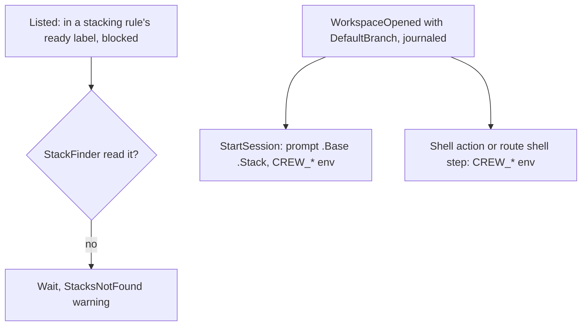

## Goal Capsule

- **Objective:** the engine reads stacks during the listing, and sessions, shell actions and route shell steps get the `CREW_*` variables of the run's base and stack.
- **Parent:** #425, part 7 of 8. Read it only for a question this part does not answer.
- **Open blockers:** none.

## Builds on

Already on main when this part starts; read the code, not these parts' files.

- Part 3 (U5): `port.StackFinder`, implemented by the GitHub tracker.
- Part 6 (U4): the core's stacked take, `StacksNotFound`, and the base and stack on `ListIssues`, `CreateWorkspace`, `StartSession` and `Script`.

## Product Contract

### Summary

The engine calls `StackFinder` during the listing, the renderers show `StacksNotFound`, and the harnesses and the shell adapter set the five `CREW_*` variables.

### Context

This wires the core's stacked take to GitHub and to the sessions, completing R4 and R8. No rule stacks until part 8 adds the `stacking` key (R1).

### Key Decisions

- **crew makes the workspace from the base when it takes the issue.** Governs R7, R8. (session-settled: user-approved — chosen over the issue's original design, where an action writes the base into `.crew-branch-base.local` and crew rebases between actions: deciding once at the take avoids a conflict mid-run and a force push.)

### Requirements

**Taking a blocked issue**

- R4. A blocked issue that R2 or R6 holds back waits in its label as a blocked issue does today, and crew checks it again at each listing; once its blocker closes, it is taken from the default branch as today.

**The workspace and the session**

- R8. Every session and shell action of a run can read the run's base branch and, when stacked, the blocker and its pull request, both in its prompt and in its environment; an unstacked run's base is the default branch.

### Key Flows

- F1. A split's chain of parts
  - **Trigger:** refinement splits #P into sub-issues #A, #B and #C, where #B is blocked by #A and #C by #B, and moves them to `crew:development:ready`.
  - **Steps:** `development` takes #A from `main`, as today. Its run ends in `crew:development:waiting review` with its pull request open. At the next listing, `development` takes #B with a workspace made from #A's branch, and #B's session opens its pull request on #A's branch and links it into a stack. #C follows the same way once #B's run ends with its pull request open.
  - **Outcome:** the stack is `main ← #A ← #B ← #C`, all in review at once. When the boss merges #A's pull request, GitHub retargets #B's to `main` and rebases #C's.
  - **Covered by:** R2, R3, R5, R7, R8, R10, R12.

### Scope Boundaries

- The `stacking` key, the README and this repository's config are part 8's.
- No new lines, cards or chips in the live view or `--plain` output for a stacked issue.

### Outstanding Questions

**Deferred to Planning**

- The names and shapes of the rule's stacking key, the prompt fields and the environment variables of R8.

Its questions deferred to planning are answered by [...] KTD8 and KTD9 (the key, the prompt fields and the variables).

### Sources / Research

- Split from #425.

## Planning Contract

### Key Technical Decisions

- KTD1. **The tracker reads stack data during the listing, through an optional port, for the candidates only.** `ListIssues` carries the ready labels of the rules with stacking on. After `Tracker.List`, the engine calls the new optional `port.StackFinder` with the listed issues that are blocked and sit only in one of those labels, and puts the issues it returns into the same `IssuesListed`. The core then decides each take in its own pure code. This follows the shipped pattern of tracker data on the issue (`docs/solutions/integration-issues/blocked-issues-dispatched-by-github-tracker.md`). It was chosen over enriching every blocked issue inside `Tracker.List`, which costs queries in repositories that never stack and changes every tracker, and over a new command and input round trip before the take, which adds a pending-take state to the scheduler. If the read fails, the candidates stay unenriched and wait (R4), and the core publishes a `StacksNotFound` warning, as it does `StatisticNotRecorded`. One unreadable query must not stop crew taking its other issues.
- KTD8. **Sessions read the stack as prompt data and as environment variables. Shell actions and route shell steps read it as environment variables.**
  - **Prompt data:** a session prompt's template data gains `.Base` and `.Stack`. `.Stack` has `Stacked`, `Blocker.Ref`, `Blocker.URL`, `PullRequest.Ref`, `PullRequest.URL` and `Branch`, all empty when the run is unstacked.
  - **Rendering:** `Prompt.Render` takes the run's stack and base next to the issue at every call site, so the render that checks a prompt when the session is asked for and the render that starts it produce the same text. `ParsePrompt` renders both a stacked and an unstacked sample, so a typo inside `{{if .Stack.Stacked}}` fails at config load.
  - **Environment:** `CREW_BASE_BRANCH`, `CREW_BLOCKER_REF`, `CREW_BLOCKER_URL`, `CREW_BLOCKER_PR_REF` and `CREW_BLOCKER_PR_URL`; the last four are empty when the run is unstacked. Codex gets them only through the process environment (`docs/solutions/security-issues/session-environment-values-in-codex-command-line.md`).
  - **Left out:** function parameters and comment templates get neither, since R8 names sessions and shell actions only.

### High-Level Technical Design

### Implementation Constraints

- Engine tests run under `testing/synctest`. Fakes come from `internal/fake`, and tests build their registry with `registry.New`.
- New optional capabilities are separate interfaces found by type assertion (AGENTS.md "New adapter").

### Sequencing

U7 is the only unit.

## Implementation Units

### U7. Engine and adapters: the listing read, and the environment

- **Goal:** the engine reads stacks during the listing, and sessions and shell actions get the `CREW_*` variables.
- **Requirements:** R4, R8; F1; KTD1, KTD8.
- **Dependencies:** U4, U5, U6.
- **Files:**
  - Engine: `internal/engine/exec.go`, `internal/engine/shell.go`, `internal/engine/engine.go` (the `StackFinder` detection).
  - Renderers: `internal/ui/lines/lines.go` and `internal/ui/tui/detail.go`, whose sealed event switches must render `StacksNotFound` as a warning, as they do `StatisticNotRecorded`.
  - Ports: `internal/port/port.go` (`Run` and `Script` fields).
  - Harnesses and shell: `internal/adapter/claude/command.go`, `internal/adapter/codex/command.go`, `internal/adapter/shell/shell.go`.
  - Fake: `internal/fake/tracker.go` (a scripted `StackFinder`).
  - Tests: those of each file above, with `TestCommandKeepsTheEnvironmentValuesOutOfItsArguments` extended.
- **Approach:**
  1. After `List`, the engine filters the listed issues to the blocked ones in the command's stacking labels, calls `StackFinder` when the tracker has it and there are some, and merges its issues back by ID.
  2. When `StackFinder` fails, the engine posts the unenriched listing with the error.
  3. `StartSession` and `Script` fields map into `port.Run` and `port.Script`, and each harness and the shell adapter sets the variables.
- **Patterns to follow:** the engine's detection of `port.PullRequestFinder`, and the existing `CREW_BRANCH`, `CREW_CODE_OWNERS` and `CREW_VERDICT_FILE` settings and their tests.
- **Test scenarios:**
  - A listing with a blocked issue in a stacking label calls the fake `StackFinder` with that issue alone, and the core receives the enriched issue.
  - A tracker without `StackFinder`, or a listing without candidates, makes no extra call.
  - A failing `StackFinder` still delivers the listing, and the view gets a `StacksNotFound` warning.
  - A stacked run's Claude and Codex sessions get all five variables with the stack's values. An unstacked run gets `CREW_BASE_BRANCH` set to the default branch and the other four empty.
  - The Codex command line contains none of the values.
  - A shell action and a route shell step get the same five variables.
  - Integration, under `synctest`: a stacking rule with the fake tracker and `StackFinder` takes a blocked issue, creates its workspace from the blocker's branch, and starts its session with the stacked prompt data and environment.
- **Verification:** engine, adapter and fake tests pass under `-race`.

## Risks & Dependencies

| Risk | Mitigation |
|---|---|
| The stack read adds up to three GraphQL calls to a poll that has candidates. | It runs only for blocked issues in a stacking rule's ready label, and each round batches its items into one call. |

## Scope Boundaries (planning additions)

- **No deduplication of the `StacksNotFound` warning.** It repeats each poll while GitHub fails, as other per-poll failures do.

## Verification Contract

| Gate | Command | Applies to |
|---|---|---|
| Tests | `go test -race ./...` | every unit |
| Format | `gofmt -l cmd internal tools` prints nothing | every unit |
| Vet | `go vet ./...` | every unit |
| Lint and layering | `go run github.com/golangci/golangci-lint/v2/cmd/golangci-lint@v2.14.0 run` | every unit |
| Coverage | `go test -race -covermode=atomic -coverpkg=./... -coverprofile=coverage.out ./...`, then `go run github.com/vladopajic/go-test-coverage/v2@v2.19.0 --config=.testcoverage.yml` (total at least 90%) | before shipping |
| Vulnerabilities | `go tool govulncheck ./...` | before shipping |

## Definition of Done

- A rule without `stacking` behaves exactly as before. The existing scheduler, resume and journal tests pass unchanged.
- No dead-end code from abandoned approaches is left in the diff.

<!-- cw-split-ce-plan: part of #425 -->

<!-- publish-split: part 7 of #425 -->

